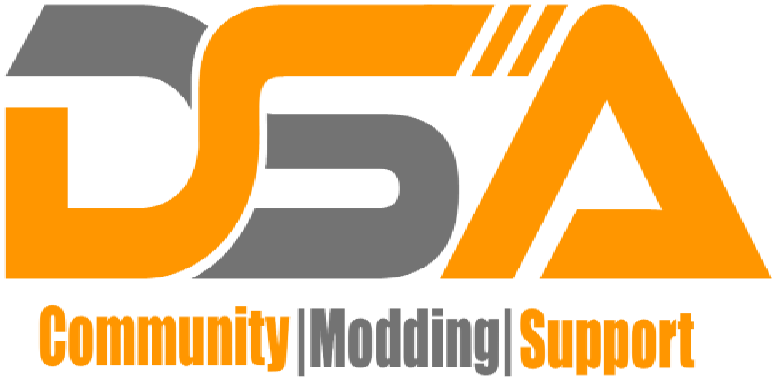
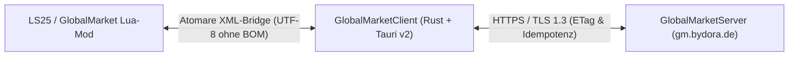

<div align="center">
  

  # GlobalMarketClient

  **Offizielle Cross-Platform Begleit-App für GlobalMarket (`LS25` / `FS25` & zukünftige Editionen)**

  [](#)
  [](https://v2.tauri.app/)
  [](#)
  [](https://github.com/D-S-Agrarservice)

  🌐 [**🇬🇧 English**](./README.md) · **Deutsch**

  [**📥 Downloads / Releases**](https://github.com/D-S-Agrarservice/GlobalMarketClient/releases) · [**🌾 FS25_GlobalMarket Mod**](https://github.com/D-S-Agrarservice/FS25_GlobalMarket) · [**📄 Schnittstellen-Doku**](./docs/External_Interface_Specification_FS25_GlobalMarket_Mod2EXE.md) · [**📜 Open-Source-Lizenzen**](./THIRD-PARTY-NOTICES.md)
</div>

---

### Inhaltsverzeichnis
- [Überblick](#überblick)
- [Highlights & Funktionen](#highlights--funktionen)
- [Architektur & Multiplayer-Topologie](#architektur--multiplayer-topologie)
- [Schnellstart für Spieler](#schnellstart-für-spieler)
- [Sicherheit & Datenschutz](#sicherheit--datenschutz)
- [Projektstruktur & Build aus dem Quellcode](#projektstruktur--build-aus-dem-quellcode)
- [Credits, Entstehung & KI-Transparenz](#credits-entstehung--ki-transparenz)
- [Support & Lizenz](#support--lizenz)

---

### Überblick

**GlobalMarketClient** ist die offizielle, plattformübergreifende Desktop-Begleit-Anwendung (**Windows, macOS, Linux / Steam Deck**) für den Landwirtschafts-Simulator-Mod **[FS25_GlobalMarket](https://github.com/D-S-Agrarservice/FS25_GlobalMarket)** von **D-S-Agrarservice**.

Da die Lua-Sandbox der GIANTS Engine aus Sicherheitsgründen keine direkten ausgehenden Internetverbindungen aus dem Spiel heraus erlaubt, übernimmt der `GlobalMarketClient` dezent im Hintergrund die schnelle, atomare XML-Brücke zwischen deinem lokalen `modSettings/FS<XX>_GlobalMarket/`-Ordner und dem weltweiten Online-Marktserver (`gm.bydora.de`).

> **Hinweis:** Der `FS25_GlobalMarket`-Mod funktioniert im Spiel auch komplett eigenständig ohne diese App als dynamischer Offline-Markt. Der `GlobalMarketClient` ist rein optional und schaltet den Live-Online-Handel frei.

---

### Highlights & Funktionen

| Funktion | Beschreibung |
| :--- | :--- |
| **Plug & Play ohne Account** | Herunterladen, starten, loshandeln – keine Registrierung und kein Login für den Offiziellen Globalen Markt nötig. |
| **100 % User-Space (Keine Admin-Rechte)** | Installiert und läuft komplett ohne Windows-Administrator-Abfrage im normalen Benutzerkontext und trägt sich niemals ungefragt in den Systemstart ein. |
| **Echter Multi-OS- & Multi-Versions-Support** | Automatische Profilerkennung für **Windows** (inkl. OneDrive), **macOS** (Universal für Apple Silicon & Intel – Steam, GIANTS & Mac App Store) und **Linux / Steam Deck** (Steam Proton), vorbereitet für `LS25` und kommende Serienteile (inkl. `-profile`-Ordner). |
| **Singleplayer, MP-Host & Dedicated Server** | Unterstützt Einzelspieler, gehosteten Multiplayer sowie das dynamische **Data-Host-Token-System** auf Dedicated Servern: **Auf dem gemieteten Dedi-Server selbst muss nichts installiert werden** – sobald **ein einziger Spieler** auf dem Server die App offen hat, handeln alle Mitspieler live am selben Online-Markt mit. |
| **Community-Märkte & eigene Logos** | Optionale Unterstützung für geschlossene Community-Märkte und individuelle Header-Logos per Schlüssel (inkl. automatischer Konvertierung von WebP/PNG/JPG in GIANTS-konformes `DXT5`-`.dds` und 1-Klick-Schnellumschalter oben im Header). |
| **Serverübergreifende Verträge & Angebote** | Leitet Lieferverträge und `±10 %`-Direktangebote des Mods (`FS25_GlobalMarket` ab v0.9.9.34) zwischen Servern weiter. Der Client schaltet das erst frei, wenn das Online-Backend die Unterstützung bestätigt (`contractsSupported`), ältere Setups handeln also ganz normal weiter. |
| **Leichtgewichtig im System-Tray** | Geschrieben in nativem **Rust + Tauri v2** – minimaler RAM-/CPU-Bedarf, unterbrechungsfreie Live-Marktwechsel, `ETag`-Caching und optionale Desktop-Benachrichtigungen bei *Großer Nachfrage*. |
| **16 Sprachen ab Werk** | Vollständig lokalisierte Oberfläche, System-Tray, Desktop-Benachrichtigungen & Live-Protokoll (inkl. aller 200 offiziellen LS25-Fruchtnamen) in **DE, EN, FR, ES, IT, PL, NL, CZ, PT, HU, DA, SV, RO, TR, RU und UK**. |

---

### Architektur & Multiplayer-Topologie



* **Dedicated-Server Data-Host-Relay:** Auf gemieteten Dedicated Servern laufen keine externen `.exe`-Programme. Sobald sich mindestens ein Spieler verbindet, auf dessen PC der `GlobalMarketClient` läuft, vergibt der LS25-Server diesem Spieler automatisch das **Data-Host-Token** (grünes HUD-Icon). Weitere Spieler mit geöffnetem Client bleiben automatisch im **Standby** (oranges HUD-Icon) für ein nahtloses Failover, während alle übrigen Mitspieler komplett ohne eigene App live mithandeln.
* **Unterbrechungsfreier Live-Marktwechsel:** Beim Wechsel zwischen dem Offiziellen Globalen Markt und gespeicherten Community-/Logo-Profilen bleibt `globalMarketOnline.xml` durchgehend bestehen und wird nach dem Handshake atomar aktualisiert, sodass auf Dedicated Servern kein ungewollter Host-Wechsel ausgelöst wird.

---

### Schnellstart für Spieler

1. Lade das passende Paket für dein Betriebssystem unter [**Releases**](https://github.com/D-S-Agrarservice/GlobalMarketClient/releases) (oder über den **D-S-Agrarservice Discord**) herunter:
   - **Windows 10/11 (x64):** `GlobalMarketClient_x.x.x_x64-setup.exe`
   - **macOS (Apple Silicon & Intel Universal):** `GlobalMarketClient_x.x.x_universal.dmg`
   - **Linux / Steam Deck (x64):** `.AppImage` / `.deb` / `.rpm`
2. Starte **`GlobalMarketClient`** vor oder während des Spiels – dein Landwirtschafts-Simulator-Profilordner wird im Normalfall automatisch erkannt *(andernfalls einmalig über **Ordner wählen…** deinen `FarmingSimulator2025`-Profilordner auswählen)*.
3. Sobald die Status-Ampel auf **Grün (`Online & Verbunden`)** springt, wechselt dein Markt im Spiel von selbst in den Live-Online-Handel. Über den Schalter **Verbinden / Trennen** oben rechts oder im System-Tray lässt sich die Online-Verbindung jederzeit pausieren (in den **Einstellungen** ist zudem wählbar, ob der Client beim Start automatisch verbindet oder getrennt startet). Ein Klick auf **`✕`** minimiert das Fenster platzsparend in den System-Tray; über **Beenden** schließt du die App komplett.

#### Hinweise zum ersten Start (Windows SmartScreen & macOS Gatekeeper)

Da der `GlobalMarketClient` ein kostenloses Community-Projekt ohne kostenpflichtige kommerzielle Microsoft-Authenticode- bzw. Apple-AppStore-/Developer-Zertifikate ist, erscheint beim allerersten Start eine einmalige Sicherheitsrückfrage des Betriebssystems. Sämtliche offiziellen Pakete werden transparent und öffentlich einsehbar direkt aus diesem Quellcode per [GitHub Actions](https://github.com/D-S-Agrarservice/GlobalMarketClient/actions) gebaut.

* **Windows 10 / 11 (Microsoft Defender SmartScreen):** Erscheint beim Ausführen der `GlobalMarketClient_x.x.x_x64-setup.exe` das blaue Fenster *„Der Computer wurde durch Windows geschützt“* (*Unbekannter Herausgeber*), klicke auf **„Weitere Informationen“** und anschließend unten auf **„Trotzdem ausführen“**.
* **macOS (Gatekeeper / Datenschutz & Sicherheit):** Da das kostenpflichtige Apple-AppStore-/Developer-Zertifikat fehlt, blockiert macOS den ersten Start nach dem Kopieren in den `Programme`-Ordner zunächst. Versuche `GlobalMarketClient` einmal zu öffnen, schließe die Meldung mit **„Fertig“** bzw. **„Abbrechen“** *(nicht in den Papierkorb legen!)* und lasse die App anschließend unter **Systemeinstellungen → Datenschutz & Sicherheit** unten im Bereich **Sicherheit** ausdrücklich über **„Trotzdem öffnen“** zu. Ab dem zweiten Start öffnet die App ohne Rückfrage.

---

### Sicherheit & Datenschutz

* **Strikte Pfad-Begrenzung:** Der Client liest und schreibt ausschließlich die dokumentierten XML- und gecachten `.dds`-Dateien innerhalb von `modSettings/FS<XX>_GlobalMarket/` sowie seine eigenen Einstellungen im Benutzerprofil.
* **Verschlüsselter Schlüssel-Tresor:** Optionale Community- und Logoschlüssel werden niemals im Klartext in der `settings.json` abgelegt, sondern über den Betriebssystem-Schutz (`Windows DPAPI` / Plattform-Tresor) verschlüsselt in `tokens.vault` gespeichert.
* **Verschlüsselte Übertragung & Origin-Pinning:** Sämtliche Live-Verbindungen laufen ausschließlich über **HTTPS / TLS (`rustls`)** mit strikter Domain-Prüfung für offizielle Community-Logo-Assets (`img.gm.bydora.de`).
* **Anonymisierte Diagnose:** Der integrierte 1-Klick-Button **Diagnose kopieren** maskiert lokale PC-Benutzernamen im Pfad (`<USER>`) und schwärzt hinterlegte Marktschlüssel automatisch vor dem Kopieren in die Zwischenablage.

---

### Projektstruktur & Build aus dem Quellcode

```text
GlobalMarketClient/
├── src/
│   └── locales/              # 16 flache JSON-Sprachdateien (DE, EN, FR, ES, IT, PL, NL, CZ, PT, HU, DA, SV, RO, TR, RU, UK)
├── src-tauri/
│   ├── src/
│   │   ├── api/              # FastAPI HTTPS-Client (ETag, Retry-/IP-Lock-Handling) & lokaler Mock-Simulator
│   │   ├── bridge/           # Coordinator, atomares UTF-8 XML-I/O, Pure-Rust DXT5-DDS-Konverter & Pfaderkennung
│   │   ├── config/           # Persistente Einstellungen & BS-verschlüsselter TokenVault (DPAPI)
│   │   └── diagnostics/      # Anonymisierter Diagnosebericht-Generator
│   └── tests/bridge_suite.rs # End-to-End Rust-Integrationstests
└── .github/workflows/        # Multi-OS CI- & Draft-Release-Pipelines (Windows, macOS Universal, Linux)
```

Voraussetzungen: **Rust** (`stable` über `rustup`), **Node.js** (`>= 24`) sowie die plattformspezifischen [Tauri-v2-Systemabhängigkeiten](https://v2.tauri.app/start/prerequisites/).

```bash
# Frontend-Abhängigkeiten installieren
npm install

# Typprüfung & Frontend-Bundle bauen
npm run build

# End-to-End Rust-Integrationstests ausführen
cargo test --manifest-path src-tauri/Cargo.toml

# Entwicklungsmodus starten (Vite + Tauri)
npm run tauri dev

# Optimiertes Produktions-Paket bauen
npm run tauri build
```

---

### Credits, Entstehung & KI-Transparenz

#### Projektteam & Mitwirkende
* **Projektleitung, GlobalMarket-Mod & Begleit-Client:** **Floowy** (*D-S-Agrarservice*)
* **Server-Architektur & Online-Backend (`FastAPI`):** **FGBxRamel** (*bydora.de*)
* **Kernteam & Projektunterstützung:** **Kastor** *(Modding-Teamleitung)*, **Murphy**, **DSA-Testteam**
* **Ideen & Externe Fachberatung:** **Tensuko** *(Konzeptideen)*, **Farmsim Tim** *(Externe Beratung)*
* **Tests, Anregungen & Community-Feedback:** **Flamy**, **PascalE**, **WeekendFarmers-Testcrew**, **OMG_its_Breide**, **OnkelSander83**

#### Historische Wurzeln & Wegbereiter
* **Die allerersten Wurzeln im LS15 — `Susi` & `Wingi`:** Um historisch vollständig und fair zu bleiben: Die ganz ursprüngliche Geschichte des Globalen Marktes geht zurück auf **Susi** und **Wingi** im **Landwirtschafts-Simulator 15**. Auch wenn es damals technisch naturgemäß noch etwas holprig war – sie hatten das Konzept als Allererstes überhaupt am Laufen und haben damit den Ur-Grundstein gelegt.
* **Besonderer Dank & Meilenstein im LS17/LS19 — `kevink98`:** Der Blick auf die LS15-Wurzeln schmälert in keiner Weise die großartige Arbeit von **kevink98**, der den **GlobalMarket** (samt damaligem Begleit-Client und der legendären **GlobalCompany**-Einbindung) im **LS17 und LS19** auf ein völlig neues Niveau gehoben und über Jahre geprägt hat. Ohne seine herausragende Umsetzung, seine Ideen und dieses Vorbild wäre dieses Projekt schlicht nicht möglich gewesen!

#### Neuentwicklung & offener Umgang mit KI (Antigravity)
Während der **GlobalMarketClient** konzeptionell an diese stolze Modding-Geschichte anknüpft (`Susi` & `Wingi` im LS15 sowie `kevink98` im LS17/LS19), ist diese plattformübergreifende **Rust + Tauri v2 + TypeScript**-Anwendung von Grund auf neu entwickelt worden – und mit massiver Unterstützung von **Antigravity (Google DeepMind AI)** entstanden.  
Ganz offen und ehrlich: Genau wie sich beim Mod niemand als unfehlbarer „Lua-Script-Wizard“ hinstellen will, behauptet hier auch niemand, ein einsamer „Rust-Programmiergott“ zu sein. Dieses Projekt ist aus purer Leidenschaft für den Landwirtschafts-Simulator und die Community entstanden – durch die Kombination aus klarer Architektur-Vision, intensivem Praxis- und Dedi-Testing im Team sowie moderner KI-Entwicklung, um einen schnellen, sicheren und zeitgemäßen Client für alle bereitzustellen.

---

### Support & Lizenz

* **Fehlermeldungen & Feedback:** Erstelle gerne ein Issue hier im GitHub-Repository (am besten direkt inklusive der Ausgabe über den Button **Diagnose kopieren** in der App) oder schau auf dem **D-S-Agrarservice Discord** vorbei.
* **Community-Übersetzungen willkommen:** Sämtliche Oberflächen- und Protokolltexte liegen übersichtlich als flache JSON-Dateien unter [`src/locales/`](./src/locales). Muttersprachler aus der Community sind jederzeit herzlich eingeladen, Formulierungen per GitHub Pull Request weiter zu verfeinern!
* **Open-Source-Lizenzen:** Hinweise zu allen verwendeten Open-Source-Bibliotheken findest du in [THIRD-PARTY-NOTICES.md](./THIRD-PARTY-NOTICES.md).
* **Copyright © D-S-Agrarservice [Floowy]. Alle Rechte vorbehalten (All Rights Reserved).** Unerlaubte Re-Uploads auf fremden Plattformen/Paywall-Links sowie die Weitergabe veränderter oder umbenannter Versionen ohne vorherige schriftliche Zustimmung sind nicht gestattet. Bitte verlinkt immer auf die offiziellen GitHub Releases.
