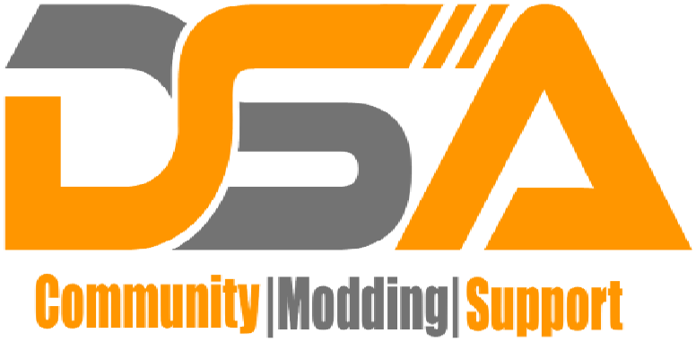
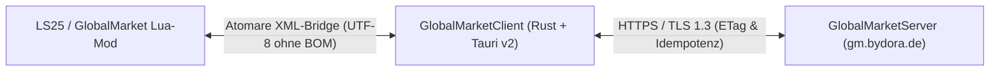

<div align="center">
  

  # GlobalMarketClient

  **Offizielle Cross-Platform Begleit-App für GlobalMarket (`LS25` / `FS25` & zukünftige Editionen)**<br/>
  *Official Cross-Platform Companion App for GlobalMarket (`FS25` & future editions)*

  [](#)
  [](https://v2.tauri.app/)
  [](#)
  [](https://github.com/D-S-Agrarservice)

  [**🇩🇪 Deutsch**](#-deutsch) · [**🇬🇧 English**](#-english) · [**📥 Downloads / Releases**](https://github.com/D-S-Agrarservice/GlobalMarketClient/releases) · [**📄 Schnittstellen-Doku**](./docs/External_Interface_Specification_FS25_GlobalMarket_Mod2EXE.md) · [**📜 Open-Source-Lizenzen**](./THIRD-PARTY-NOTICES.md)
</div>

---

## 🇩🇪 Deutsch

### Überblick

**GlobalMarketClient** ist die offizielle, plattformübergreifende Desktop-Begleit-Anwendung (**Windows, macOS, Linux / Steam Deck**) für den Landwirtschafts-Simulator-Mod **`GlobalMarket`** von **D-S-Agrarservice**.

Da die Lua-Sandbox der GIANTS Engine aus Sicherheitsgründen keine direkten Internetverbindungen aus dem Spiel heraus erlaubt, übernimmt der `GlobalMarketClient` im Hintergrund die sichere Echtzeit-Brücke zwischen deinem lokalen `modSettings/FS<XX>_GlobalMarket/`-Ordner und dem weltweiten Online-Marktserver (`gm.bydora.de`).

### Highlights & Funktionen

| Funktion | Beschreibung |
| :--- | :--- |
| **Plug & Play ohne Account** | Herunterladen, starten, loshandeln – keine Registrierung und kein Login für den öffentlichen Weltmarkt nötig. |
| **100 % User-Space (Keine Admin-Rechte)** | Läuft komplett ohne Administrator-Rechte im Benutzerkontext und nistet sich nicht ungefragt in den Systemstart ein. |
| **Echter Multi-OS- & Multi-Versions-Support** | Automatische Profilerkennung für **Windows** (inkl. OneDrive), **macOS** (Steam & App Store) und **Linux** (Steam Proton) sowie für `FS25` und kommende Serienteile (`-profile`-Support & manuelle Ordnerwahl inklusive). |
| **Singleplayer, MP-Host & Dedicated Server** | Unterstützt lokalen Einzelspieler, gehosteten Multiplayer sowie das dynamische **Data-Host-Token-System** auf Dedicated Servern inkl. nahtlosem Failover. |
| **Community- & Privat-Märkte** | Optionale Unterstützung für eigene Community-Märkte und individuelle Header-Logos per Schlüssel. |
| **Leichtgewichtig im System-Tray** | Geschrieben in nativem **Rust + Tauri v2** – minimaler RAM-/CPU-Bedarf im Hintergrund und optionale Desktop-Benachrichtigungen bei *Großer Nachfrage*. |
| **5 Sprachen ab Werk** | Vollständig lokalisiert inkl. Live-Aktivitätsprotokoll auf **Deutsch, Englisch, Französisch, Spanisch und Polnisch**. |

### Funktionsweise (Architektur)



### Schnellstart für Spieler

1. Lade die aktuelle Version für dein Betriebssystem unter [**Releases**](https://github.com/D-S-Agrarservice/GlobalMarketClient/releases) (oder über den **D-S-Agrarservice Discord**) herunter.
2. Starte **`GlobalMarketClient`** vor oder während des Spiels – dein Landwirtschafts-Simulator-Profilordner wird in der Regel automatisch erkannt *(andernfalls einmalig per **Ordner wählen…** auf deinen `FarmingSimulator2025`-Profilordner zeigen)*.
3. Sobald die Status-Ampel auf **Grün (`Verbunden`)** springt, wechselt dein Markt im Spiel automatisch in den Live-Online-Handel.

### Sicherheit & Datenschutz

* **Strikte Pfad-Begrenzung:** Der Client liest und schreibt ausschließlich die definierten XML-Austauschdateien innerhalb von `modSettings/FS<XX>_GlobalMarket/` sowie seine eigene `settings.json`.
* **Verschlüsselte Übertragung:** Sämtliche Live-Verbindungen laufen ausschließlich über **HTTPS / TLS (`rustls`)** mit striktem Origin-Pinning für Community-Assets.
* **Anonymisierte Diagnose:** Der integrierte 1-Klick-Diagnosebericht maskiert lokale Benutzernamen im Dateipfad (`<USER>`) und schwärzt hinterlegte Community-/Marktschlüssel automatisch vor dem Kopieren.

### Lokale Entwicklung & Build aus dem Quellcode

Voraussetzungen: **Rust** (`stable` über `rustup`) und **Node.js** (`>= 24`) sowie die plattformspezifischen [Tauri-v2-Systemabhängigkeiten](https://v2.tauri.app/start/prerequisites/).

```bash
# Frontend-Abhängigkeiten installieren
npm install

# Typprüfung & Frontend-Bundle bauen
npm run build

# Rust-Integrationstests ausführen
cargo test --manifest-path src-tauri/Cargo.toml

# Entwicklungsmodus starten (Vite + Tauri)
npm run tauri dev

# Optimierten Release-Build erstellen
npm run tauri build
```

### Credits & Mitwirkende

* **Projektleitung, GlobalMarket-Mod & Client:** **Floowy** (*D-S-Agrarservice*)
* **Server-Architektur & Online-Backend:** **FGBxRamel** (*bydora.de*)
* **Besonderer Dank (Ursprungsidee & LS-Wegbereiter):** **kevink98**
* **Kernteam & Projektunterstützung:** **Kastor** *(Modding-Teamleitung)*, **Murphy**, **DSA-Testteam**
* **Ideen & Externe Fachberatung:** **Tensuko** *(Konzeptideen)*, **Farmsim Tim** *(Externe Beratung)*
* **Tests, Anregungen & Feedback:** **Flamy**, **PascalE**, **WeekendFarmers-Testcrew**, **OMG_its_Breide**, **OnkelSander83**

Hinweise zu verwendeten Open-Source-Bibliotheken findest du in [THIRD-PARTY-NOTICES.md](./THIRD-PARTY-NOTICES.md).

---

## 🇬🇧 English

### Overview

**GlobalMarketClient** is the official cross-platform desktop companion application (**Windows, macOS, Linux / Steam Deck**) for the **`GlobalMarket`** Farming Simulator mod by **D-S-Agrarservice**.

Because the GIANTS Engine Lua sandbox blocks direct outbound network sockets from inside the game, `GlobalMarketClient` runs quietly in the background as a fast, atomic XML bridge between your local `modSettings/FS<XX>_GlobalMarket/` directory and the live online market backend (`gm.bydora.de`).

### Key Features

| Feature | Description |
| :--- | :--- |
| **Zero-Login Plug & Play** | Launch and trade right away on the public global market — no registration or user account required. |
| **100% User-Space (No Admin Rights)** | Installs and runs cleanly without elevated privileges and never adds forced OS startup entries. |
| **Cross-Platform & Multi-Edition Ready** | Automatic profile discovery for **Windows** (including OneDrive), **macOS** (Steam & App Store), and **Linux** (Steam Proton), supporting `FS25` and upcoming Farming Simulator titles (including custom `-profile` directories). |
| **SP, MP Host & Dedicated Server Support** | Works seamlessly in Singleplayer, hosted Multiplayer, and on Dedicated Servers via the mod's dynamic **Data-Host Token** failover system. |
| **Community & Private Markets** | Optional key-based support for private community markets and custom community header logos. |
| **Lightweight System Tray App** | Built with **Rust + Tauri v2** for a tiny memory footprint, atomic BOM-free UTF-8 XML I/O, `ETag` bandwidth caching, and optional *Great Demand* desktop notifications. |
| **5 Built-In Languages** | Fully localized UI and live activity log in **German, English, French, Spanish, and Polish**. |

### Quick Start for Players

1. Download the latest package for your OS from [**Releases**](https://github.com/D-S-Agrarservice/GlobalMarketClient/releases) (or via the **D-S-Agrarservice Discord**).
2. Start **`GlobalMarketClient`** before or while playing — your Farming Simulator profile folder is detected automatically *(or pick your `FarmingSimulator2025` folder once via **Select folder…**)*.
3. Once the status indicator turns **Green (`Online`)**, your in-game GlobalMarket automatically switches to live online trading.

### Security & Privacy

* **Scoped File Access:** Only reads and writes the documented XML bridge files inside `modSettings/FS<XX>_GlobalMarket/` plus its own user `settings.json`.
* **Encrypted Transport:** All live backend traffic uses **HTTPS / TLS (`rustls`)** with strict origin pinning for community logo assets.
* **Redacted Diagnostics:** The built-in 1-click diagnostic report automatically scrubs OS usernames (`<USER>`) and masks configured market keys before copying to your clipboard.

### Building from Source

Prerequisites: **Rust** (`stable` via `rustup`), **Node.js** (`>= 24`), and the standard [Tauri v2 prerequisites](https://v2.tauri.app/start/prerequisites/) for your OS.

```bash
npm install
npm run build
cargo test --manifest-path src-tauri/Cargo.toml
npm run tauri build
```

### Credits & Acknowledgments

* **Project Lead, GlobalMarket Mod & Companion Client:** **Floowy** (*D-S-Agrarservice*)
* **Server Architecture & Online Backend:** **FGBxRamel** (*bydora.de*)
* **Special Appreciation (Original Concept & FS Pioneer):** **kevink98**
* **Core Team & Project Support:** **Kastor** *(Modding Team Lead)*, **Murphy**, **DSA-Testteam**
* **Concept Ideas & External Consulting:** **Tensuko** *(Concept Ideas)*, **Farmsim Tim** *(External Consulting)*
* **Testing, Suggestions & Feedback:** **Flamy**, **PascalE**, **WeekendFarmers-Testcrew**, **OMG_its_Breide**, **OnkelSander83**

Third-party open-source software notices are documented in [THIRD-PARTY-NOTICES.md](./THIRD-PARTY-NOTICES.md).
