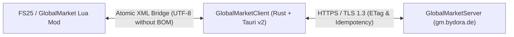

<div align="center">
  

  # GlobalMarketClient

  **Official Cross-Platform Companion App for GlobalMarket (`FS25` & future editions)**

  [](#)
  [](https://v2.tauri.app/)
  [](#)
  [](https://github.com/D-S-Agrarservice)

  🌐 **English** · [**🇩🇪 Deutsch**](./README.de.md)

  [**📥 Downloads / Releases**](https://github.com/D-S-Agrarservice/GlobalMarketClient/releases) · [**🌾 FS25_GlobalMarket Mod**](https://github.com/D-S-Agrarservice/FS25_GlobalMarket) · [**📄 Interface Spec**](./docs/External_Interface_Specification_FS25_GlobalMarket_Mod2EXE.md) · [**📜 Third-Party Notices**](./THIRD-PARTY-NOTICES.md)
</div>

---

### Table of Contents
- [Overview](#overview)
- [Key Features](#key-features)
- [Architecture & Multiplayer Topology](#architecture--multiplayer-topology)
- [Quick Start for Players](#quick-start-for-players)
- [Security & Privacy](#security--privacy)
- [Project Structure & Building from Source](#project-structure--building-from-source)
- [Credits, Origins & AI Transparency](#credits-origins--ai-transparency)
- [Support & License](#support--license)

---

### Overview

**GlobalMarketClient** is the official cross-platform desktop companion application (**Windows, macOS, Linux / Steam Deck**) for the **[FS25_GlobalMarket](https://github.com/D-S-Agrarservice/FS25_GlobalMarket)** Farming Simulator mod by **D-S-Agrarservice**.

Because the GIANTS Engine Lua sandbox blocks direct outbound network connections from inside the game for security reasons, `GlobalMarketClient` runs quietly in the background as a fast, atomic XML bridge between your local `modSettings/FS<XX>_GlobalMarket/` folder and the live online market backend (`gm.bydora.de`).

> **Note:** The `FS25_GlobalMarket` mod works completely standalone as a dynamic simulated offline market without this app. Running `GlobalMarketClient` is completely optional and unlocks live worldwide and community-wide online trading.

---

### Key Features

| Feature | Description |
| :--- | :--- |
| **Zero-Login Plug & Play** | Download, launch, and trade right away on the Official Global Market — no registration or user account required. |
| **100% User-Space (No Admin Rights)** | Installs and runs cleanly in your standard user account without Windows UAC / admin prompts and never adds forced autostart entries. |
| **True Cross-Platform & Multi-Edition Support** | Automatic profile discovery for **Windows** (including OneDrive), **macOS** (Universal Apple Silicon & Intel — Steam, GIANTS & Mac App Store), and **Linux / Steam Deck** (Steam Proton), ready for `FS25` and upcoming Farming Simulator editions (including custom `-profile` folders). |
| **SP, MP Host & Dedicated Server Ready** | Works seamlessly in Singleplayer, hosted Multiplayer, and on Dedicated Servers via the mod's dynamic **Data-Host Token** failover system — **nothing needs to be installed on your rented Dedicated Server**, and **one connected player running the app is enough for everyone on the server to trade online**. |
| **Community Markets & Custom Logos** | Optional key-based support for private community markets and custom community/creator header logos (including automatic pure-Rust WebP/PNG/JPG to GIANTS `DXT5` `.dds` conversion and 1-click live market switching in the header). |
| **Cross-Server Contracts & Offers** | Relays supply contracts and `±10 %` direct offers of the mod (`FS25_GlobalMarket` v0.9.9.34+) between servers. The client only enables this once the online backend confirms support (`contractsSupported`), so older setups keep trading normally. |
| **Coming Next: Cross-Server Used Vehicle Market** | The mod's used vehicle market (`FS25_GlobalMarket` v0.10.0+) already runs between all farms on one server. Relaying listings between servers is specified and planned for an upcoming client release (enabled via `vehiclesSupported` once the backend supports it). |
| **Lightweight System Tray App** | Built with **Rust + Tauri v2** for minimal RAM/CPU overhead, zero-gap live market handovers, `ETag` bandwidth caching, and optional *Great Demand* desktop notifications. |
| **16 Built-In Languages** | Fully localized UI, system tray, desktop notifications, and live activity log (including all 200 official FS25 crop names) in **DE, EN, FR, ES, IT, PL, NL, CZ, PT, HU, DA, SV, RO, TR, RU, and UK**. |

---

### Architecture & Multiplayer Topology



* **Dedicated Server Data-Host Relay:** Rented Dedicated Servers never run external `.exe` tools. As soon as at least one connected player runs `GlobalMarketClient` on their PC, the FS25 server assigns that player the **Data-Host Token** (green HUD icon). Additional players with an active client wait in **Standby** (orange HUD icon) for seamless automatic failover, while all other players on the server trade live without needing the app at all.
* **Zero-Gap Live Market Switching:** Switching between the Official Global Market and saved Community/Logo profiles in the client header updates the active market at runtime without interrupting `globalMarketOnline.xml` heartbeats.

---

### Quick Start for Players

1. Download the latest installer for your operating system from [**Releases**](https://github.com/D-S-Agrarservice/GlobalMarketClient/releases) (or via the **D-S-Agrarservice Discord**):
   - **Windows 10/11 (x64):** `GlobalMarketClient_x.x.x_x64-setup.exe`
   - **macOS (Apple Silicon & Intel Universal):** `GlobalMarketClient_x.x.x_universal.dmg`
   - **Linux / Steam Deck (x64):** `.AppImage` / `.deb` / `.rpm`
2. Launch **`GlobalMarketClient`** before or while playing — your Farming Simulator profile folder is detected automatically *(or pick your `FarmingSimulator2025` folder once via **Select folder…**)*.
3. Once the status indicator turns **Green (`Online & Connected`)**, your in-game GlobalMarket automatically switches to live online trading. You can pause or resume the online connection anytime via the **Connect / Disconnect** switch in the top-right header or system tray (and configure automatic vs. manual startup connection in **Settings**). Closing the window (`✕`) minimizes the client quietly to the system tray; use **Quit** to exit completely.

#### First-Time Launch Notes (Windows SmartScreen & macOS Gatekeeper)

Because `GlobalMarketClient` is a free community modding tool without paid commercial Microsoft Authenticode or Apple Store / Developer ID code-signing certificates, your operating system will show a one-time prompt on first install/launch. All official installers are built transparently and reproducibly directly from this public source repository via [GitHub Actions](https://github.com/D-S-Agrarservice/GlobalMarketClient/actions).

* **Windows 10 / 11 (Microsoft Defender SmartScreen):** When running `GlobalMarketClient_x.x.x_x64-setup.exe`, Windows may display *"Windows protected your PC"* (*Unknown publisher*). Click **More info** → **Run anyway** to start the user-space installer.
* **macOS (Gatekeeper / Privacy & Security):** Because no Apple App Store / Developer ID certificate is attached, macOS blocks the first launch after dragging `GlobalMarketClient.app` to `Applications`. Attempt to open the app once and close the prompt with **Done** / **Cancel** *(do **not** click Move to Trash)*, then open **System Settings → Privacy & Security**, scroll down to the **Security** section, and explicitly allow the app via **Open Anyway**. Subsequent launches start normally.

---

### Security & Privacy

* **Strictly Scoped File Access:** Reads and writes exclusively the documented XML and cached `.dds` logo files inside `modSettings/FS<XX>_GlobalMarket/`, plus its own local configuration directory.
* **OS-Encrypted Key Vault:** Optional Community and Logo keys are never stored in plaintext inside `settings.json`; they are sealed locally via operating-system encryption (`Windows DPAPI` / platform vault) in `tokens.vault`.
* **Encrypted Transport & Origin Pinning:** All live backend traffic uses **HTTPS / TLS (`rustls`)** with strict domain pinning for official community logo CDN assets (`img.gm.bydora.de`).
* **Redacted Support Diagnostics:** The built-in 1-click **Copy Diagnostics** report automatically scrubs local OS usernames (`<USER>`) and masks all saved market keys before copying to your clipboard.

---

### Project Structure & Building from Source

```text
GlobalMarketClient/
├── docs/                     # Mod <-> client interface spec (single source), backend handoff notes & openapi.json
├── src/                      # TypeScript frontend (Vite): main.ts, i18n.ts, styles.css, types.ts
│   ├── assets/               # Logo & UI images
│   └── locales/              # 16 flat JSON UI dictionaries (DE, EN, FR, ES, IT, PL, NL, CZ, PT, HU, DA, SV, RO, TR, RU, UK)
├── src-tauri/
│   ├── src/
│   │   ├── api/              # FastAPI HTTPS client (ETag, retry/IP-lock handling) & local Mock simulator
│   │   ├── bridge/           # Coordinator, atomic UTF-8 XML I/O, pure-Rust DXT5 DDS encoder & path discovery
│   │   ├── config/           # Persistent settings & OS-encrypted TokenVault (DPAPI)
│   │   ├── diagnostics/      # Privacy-redacted diagnostic report builder
│   │   ├── commands.rs       # Tauri IPC commands between the TypeScript UI and the bridge
│   │   ├── tray.rs           # System tray, close-to-tray handling & desktop notifications
│   │   └── lib.rs / main.rs  # App setup & entry point
│   └── tests/bridge_suite.rs # End-to-end Rust integration test suite
└── .github/workflows/        # Multi-OS CI & Draft Release pipelines (Windows, macOS Universal, Linux)
```

Prerequisites: **Rust** (`stable` via `rustup`), **Node.js** (`>= 24`), and the standard [Tauri v2 system prerequisites](https://v2.tauri.app/start/prerequisites/) for your OS.

```bash
# Install frontend dependencies
npm install

# Type-check & build frontend bundle
npm run build

# Run end-to-end Rust integration tests
cargo test --manifest-path src-tauri/Cargo.toml

# Run in development mode (Vite + Tauri)
npm run tauri dev

# Build optimized production bundle
npm run tauri build
```

---

### Credits, Origins & AI Transparency

#### Project Team & Contributors
* **Project Lead, GlobalMarket Mod & GlobalMarketClient:** **Floowy** (*D-S-Agrarservice*)
* **Server Architecture & Online Backend (`FastAPI`):** **FGBxRamel** (*bydora.de*)
* **Core Team & Project Support:** **Kastor** *(Modding Team Lead)*, **Murphy**, **DSA-Testteam**
* **Concept Ideas & External Consulting:** **Tensuko** *(Concept Ideas)*, **Farmsim Tim** *(External Consulting)*
* **Testing, Suggestions & Community Feedback:** **Flamy**, **PascalE**, **WeekendFarmers-Testcrew**, **OMG_its_Breide**, **OnkelSander83**

#### Historic Roots & Pioneers
* **Historic FS15 Pioneers — `Susi` & `Wingi`:** To give full and historically accurate credit where it is due: the very first origins of the Global Market idea go all the way back to **Susi** and **Wingi** in **Farming Simulator 15**. Even though things were naturally still a bit rough around the edges in those early days, they were the very first to get a Global Market up and running and laid the original foundation.
* **Special Thanks & FS17/FS19 Milestone — `kevink98`:** Recognizing the FS15 roots in no way diminishes the outstanding work of **kevink98**, who brought **GlobalMarket** (along with its original companion client and his legendary **GlobalCompany** integration) to life in **FS17 and FS19** with a phenomenal implementation. Without his pioneering architecture, dedication, and inspiration, this project would never have been possible.

#### Ground-Up Redevelopment & AI Transparency
While **GlobalMarketClient** builds conceptually upon that proud modding heritage (`Susi` & `Wingi` in FS15, and `kevink98` in FS17/FS19), this cross-platform **Rust + Tauri v2 + TypeScript** application is a complete ground-up development built with massive hands-on assistance from modern AI development tools (**Antigravity** and **Claude Code**).  
Full transparency: just as nobody on the mod side claims to be a solo Lua scripting wizard, nobody here claims to be a solo Rust systems-programming god either. This client exists out of pure passion for Farming Simulator and its community — combining clear architectural goals, thorough real-world multiplayer/Dedi testing, and modern AI engineering to deliver a fast, safe, and reliable companion app for everyone.

---

### Support & License

* **Bug Reports & Feedback:** Please open an Issue in this repository (and include the output of the in-app **Copy Diagnostics** button when reporting connection or path issues) or visit the **D-S-Agrarservice Discord**.
* **Community Translation Improvements Welcome:** All interface and live-log texts live in clean flat JSON files under [`src/locales/`](./src/locales). Native speakers are warmly invited to refine phrasing or suggest improvements via a simple GitHub Pull Request!
* **Open-Source Notices:** Third-party open-source library licenses are documented in [THIRD-PARTY-NOTICES.md](./THIRD-PARTY-NOTICES.md).
* **Copyright © D-S-Agrarservice [Floowy]. All Rights Reserved.** Unauthorized re-uploads to third-party mirrors/paywalls or redistribution of modified/rebranded builds without prior written permission are not permitted. Please always link to the official GitHub Releases.
