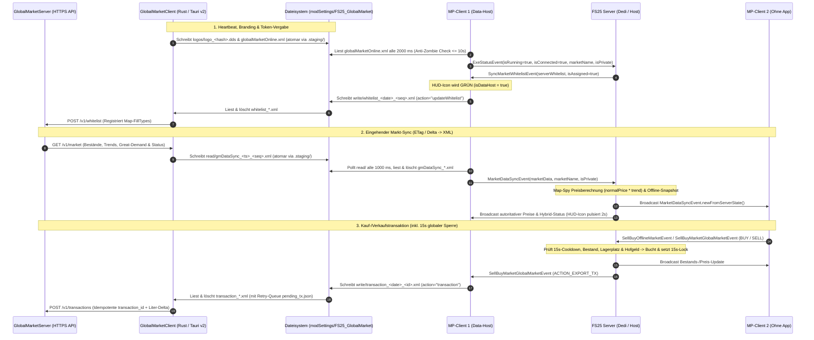

# GlobalMarket – Externe Schnittstellen-Spezifikation & Datenverkehr: Lua <-> Rust Client XML-Bridge

Dieses Dokument ist die verbindliche technische Spezifikation für den Datenverkehr zwischen dem FS25 Lua-Mod (`FS25_GlobalMarket` bzw. zukünftigen `FS<YY>_GlobalMarket`-Editionen) und der offiziellen plattformübergreifenden Desktop-Applikation **`GlobalMarketClient`** (Repository `D-S-Agrarservice/GlobalMarketClient`, implementiert in **Rust + Tauri v2** für Windows, macOS & Linux / Steam Deck) inklusive Online-Backend (`gm.bydora.de`).

> **Einzige Quelle:** Diese Datei im Client-Repo (`docs/`) ist die maßgebliche Fassung. Die frühere Kopie im Mod (`.agents/skills/lua/references/projects/FS25_GlobalMarket_EXE_Backend_Bridge.md`) verweist nur noch hierher. Änderungen an der Schnittstelle werden ausschließlich hier gepflegt.

Da die Lua-Sandbox der GIANTS Engine aus Sicherheitsgründen keine direkten ausgehenden HTTP-, TCP- oder WebSocket-Verbindungen zulässt, erfolgt die gesamte Kommunikation zwischen Spiel und Desktop-Client asynchron und atomar über XML- und `.dds`-Dateien im lokalen `modSettings`-Ordner des Spielers.

---

## 1. Verzeichnisstruktur & Datei-I/O-Regeln

### 1.1 Gemeinsames Austausch-Verzeichnis (`modSettings/FS25_GlobalMarket/`)
Sämtliche Dateien der Schnittstelle liegen gebündelt in einem einzigen Ordner innerhalb des Benutzerprofils des Landwirtschafts-Simulators (`src-tauri/src/bridge/paths.rs`):

* **Windows (Standard & OneDrive `Documents` / `Dokumente`):**
  `%USERPROFILE%\Documents\My Games\FarmingSimulator2025\modSettings\FS25_GlobalMarket\`
  *(sowie vorrangig `%OneDriveConsumer%` und `%OneDrive%`, falls OneDrive-Ordnersicherung aktiv ist)*
* **macOS (Steam / GIANTS Standalone):**
  `~/Library/Application Support/FarmingSimulator2025/modSettings/FS25_GlobalMarket/`
* **macOS (Mac App Store Sandbox-Container):**
  `~/Library/Containers/com.giants-software.farmingsim25/Data/Library/Application Support/FarmingSimulator2025/modSettings/FS25_GlobalMarket/`
* **Linux / SteamOS / Steam Deck (Steam Proton):**
  `<SteamLibrary>/steamapps/compatdata/2300320/pfx/drive_c/users/steamuser/Documents/My Games/FarmingSimulator2025/modSettings/FS25_GlobalMarket/`
  *(inklusive Auswertung sekundärer Steam-Bibliotheken über `steamapps/libraryfolders.vdf`)*

```rust
// Auszug aus src-tauri/src/bridge/paths.rs (Multi-OS & Multi-Edition Pfadauflösung)
pub struct BridgePaths {
    pub game_edition: String,           // z. B. "FS25" (oder zukünftig "FS28")
    pub profile_dir: PathBuf,           // .../FarmingSimulator2025 (oder eigener -profile Ordner)
    pub bridge_root: PathBuf,           // .../modSettings/FS25_GlobalMarket
    pub online_xml_file: PathBuf,       // .../modSettings/FS25_GlobalMarket/globalMarketOnline.xml
    pub server_whitelist_file: PathBuf, // .../modSettings/FS25_GlobalMarket/server_whitelist.xml
    pub read_dir: PathBuf,              // .../modSettings/FS25_GlobalMarket/read
    pub write_dir: PathBuf,             // .../modSettings/FS25_GlobalMarket/write
    pub logos_dir: PathBuf,             // .../modSettings/FS25_GlobalMarket/logos
    pub staging_dir: PathBuf,           // .../modSettings/FS25_GlobalMarket/.staging
}
```

> [!IMPORTANT]
> **Manuelle Verzeichnisauswahl & `-profile`-Fallback (`resolve_bridge_paths`):**
> Viele Spieler nutzen verschobene Dokumenten-Ordner, eigene Laufwerke oder starten den LS25 mit dem Startparameter `-profile <Pfad>`. Der `GlobalMarketClient` bietet daher in den Einstellungen eine manuelle Ordnerauswahl, die wahlweise den Profilordner (`FarmingSimulator2025` bzw. Ordner mit `gameSettings.xml`), den Unterordner `modSettings` oder direkt `modSettings/FS25_GlobalMarket` akzeptiert und dauerhaft in `settings.json` speichert.

### 1.2 Übersicht aller Austausch-Dateien & Unterordner

Alle Pfade verstehen sich relativ zu `.../FarmingSimulator2025/modSettings/FS25_GlobalMarket/`:

| Relativer Pfad | Richtung | Lebenszyklus & Zweck |
| :--- | :--- | :--- |
| `globalMarketOnline.xml` | **Client -> Lua** | **Persistente Statusdatei** (Heartbeat, Backend-Verbindungsstatus, Client-Version, `minVersion`, optionales `latestVersion` sowie 3-Stufen-Markt-Branding). Wird vom Rust-Client alle `3–5 s` atomar aktualisiert und von Lua alle `2000 ms` gelesen (**nicht von Lua gelöscht!**). Bei einem internen Live-Markt-/Token-Wechsel bleibt die Datei bis zum atomaren Überschreiben durch den neuen Handshake bestehen (nur `read/` & `.staging/` werden geleert); beim echten Beenden des Clients, beim Ausschalten der Online-Verbindung oder beim Profilordner-Wechsel löscht der Client die Datei sofort (`remove_heartbeat_xml`). |
| `logos/logo_<hash12>.dds` | **Client -> Lua** | **Gecachte Branding-Textur:** Vom Rust-Client aus `.webp`/`.png`/`.jpg`/`.dds` erzeugte GIANTS-konforme `512x256` `BC3/DXT5`-Textur inkl. 10 Mipmaps (`174.928 Bytes`), referenziert über `logoFile` in `globalMarketOnline.xml`. |
| `.staging/stage_<pid>_<seq>.tmp` | **Client intern** | **Temporärer Staging-Ordner** außerhalb von `read/`, in dem der Rust-Client neue XML- und `.dds`-Dateien vollständig schreibt und flusht, bevor sie per `std::fs::rename` atomar ans Ziel verschoben werden. |
| `modInfo.xml` | **Lua -> Client** | **Persistente Statusdatei** (Mod-Version, Mod-Hash & geladene Karte, siehe 3.1.1). Wird von Lua bei jedem Kartenstart auf jedem Spieler-PC neu geschrieben (nie auf `g_dedicatedServer`) und vom Client nur gelesen (**nicht vom Client gelöscht!**). |
| `server_whitelist.xml` | **Lua (Server) -> Lokal** | Statische Referenzliste aller auf der geladenen Map registrierten FillTypes (wird beim Map-Start im Singleplayer bzw. auf dem Host/Dedicated Server erzeugt). |
| `write/whitelist_<date>_<seq>.xml` | **Lua (Data-Host) -> Client** | **Transferdatei (`action="updateWhitelist"`):** Wird vom aktiven Data-Host geschrieben, sobald er vom Server den Data-Host-Token erhält oder im Client live den Markt wechselt. **Client liest & löscht diese Datei.** |
| `read/gmDataSync_<ts>[_<seq>].xml` | **Client -> Lua (Data-Host)** | **Transferdatei (`action="marketData"`):** Eingehende globale Marktdaten. Wird vom Data-Host alle `1000 ms` gepollt, chronologisch sortiert eingelesen und gelöscht. Der Rust-Client behält bei geschlossenem Spiel maximal die `3` neuesten Snapshots vor (`MAX_RETAINED_MARKET_SYNC_FILES = 3`) und räumt `read/` beim Beenden auf. |
| `read/gmContractSync_<ts>[_<seq>].xml` | **Client -> Lua (Data-Host)** | **Transferdatei (`action="contractData"`):** Eingehende Online-Verträge, Direktangebote, Action-Acks (`actionResults`) und `settlements` (Stage 2). Wird vom selben `1000 ms`-Poll gelesen & gelöscht. Separate Dateinamensklasse, damit `MAX_RETAINED_MARKET_SYNC_FILES` niemals ungelesene Quittungen verdrängt. |
| `write/transaction_<date>_<id>.xml` | **Lua (Data-Host) -> Client** | **Transferdatei (`action="transaction"`):** Ausgehende Kauf-/Verkaufstransaktion in ganzen Litern. **Client liest, überträgt idempotent ans Backend & löscht diese Datei.** |
| `write/marketSwitch_<date>_<seq>.xml` | **Lua (Data-Host) -> Client** | **Transferdatei (`action="selectMarket"`, siehe 3.1.2):** Ingame-Marktwechsel des aktiven Data-Hosts auf ein im Client gespeichertes Marktprofil. **Client liest, prüft die Profil-ID & löscht diese Datei.** |
| `write/contractAction_<date>_<id>.xml` | **Lua (Data-Host) -> Client** | **Transferdatei (`action="contractAction"`):** Ausgehende Stage-2-Aktion (`CREATE_*`, `CANCEL_*`, `ACCEPT_CONTRACT`, `DELIVER_CONTRACT`, `BUY_OFFER`, `ACK_SETTLEMENT`, `REQUEST_SYNC`). **Client liest, sendet idempotent ans Backend & löscht diese Datei.** |
| `read/gmVehicleSync_<ts>[_<seq>].xml` | **Client -> Lua (Data-Host)** | **Transferdatei (`action="vehicleData"`, Stage 3, ab Client `0.9.17`):** Eingehende Online-Fahrzeugangebote, Action-Acks und `settlements` des Gebrauchtfahrzeugmarkts (siehe 3.6). Wird vom selben `1000 ms`-Poll gelesen & gelöscht. Eigene Dateinamensklasse wie `gmContractSync_*` (eigene Aufbewahrungsgrenze von `32` ungelesenen Dateien), damit keine andere Bereinigung ungelesene Quittungen verdrängt. |
| `write/vehicleAction_<date>_<id>.xml` | **Lua (Data-Host) -> Client** | **Transferdatei (`action="vehicleAction"`, Stage 3, ab Client `0.9.17`):** Ausgehende Fahrzeugmarkt-Aktion (`CREATE_LISTING`, `CANCEL_LISTING`, `BUY_LISTING`, `ACK_SETTLEMENT`, `REQUEST_SYNC`). **Client liest, sendet idempotent ans Backend & löscht diese Datei.** |

### 1.3 Verbindliche Datei-I/O-Regeln für Rust (`GlobalMarketClient`) & Lua
1. **Atomares Schreiben über `.staging/` (Schutz vor Halb-Lese-Zugriffen & `getFiles`-Races):**
   Da Lua den Ordner `read/` alle `1000 ms` per `getFiles()` scannt und `globalMarketOnline.xml` alle `2000 ms` liest, darf niemals direkt in Zieldateien gestreamt oder eine `.tmp`-Datei innerhalb von `read/` abgelegt werden.
   * **Umsetzung in Rust (`atomic_write_utf8_no_bom`):** Datei vollständig in `.staging/stage_<pid>_<seq>.tmp` schreiben, per `file.sync_all()` auf den Datenträger flushen, Handle schließen und anschließend per `std::fs::rename(&tmp_path, target_path)` atomar ans Ziel verschieben (inkl. bis zu `5x 40 ms` Retry, falls die GIANTS Engine `globalMarketOnline.xml` unter Windows für wenige Millisekunden sperrt).
2. **Encoding zwingend UTF-8 OHNE BOM:**
   Der C++-XML-Parser der GIANTS Engine verweigert Dateien mit UTF-8 Byte Order Mark (`0xEF 0xBB 0xBF`). Rust-Strings (`&str`) sind nativ UTF-8 ohne BOM; zusätzlich entfernt der Writer vor dem Schreiben jedes führende `\u{FEFF}` (`debug_assert!(!bytes.starts_with(&[0xEF, 0xBB, 0xBF]))`).
3. **Invariante Zahlenformatierung & 32-Bit-Integer-Clamping:**
   Fließkommazahlen werden sprachunabhängig mit Dezimalpunkt formatiert (`format!("{trend:.2}")`). Ganzzahlige Liter-Bestände (`fillLevel`, `greatDemandRemaining`) werden vor dem XML-Export auf `0..=i32::MAX` (`2_147_483_647`) begrenzt, da `XMLFile:getInt()` in der GIANTS Engine vorzeichenbehaftete 32-Bit-Integer liest.
4. **Polymorphes Wildcard-Routing im `write/`-Ordner:**
   Der Rust-Watcher (`notify`-Filesystem-Events + `1 s` Polling-Fallback) verarbeitet alle `*.xml`-Dateien in `write/`, wertet per `quick-xml` das Root-Attribut `<gmDataSync action="...">` aus (`updateWhitelist` vs. `transaction`, unbekannte Actions werden ignoriert) und löscht die Datei nach Übernahme sofort (`std::fs::remove_file`).

---

## 2. Rollenverteilung & Netzwerk-Topologie (SP / MP-Host / Dedicated Server)

Der Desktop-Client (`GlobalMarketClient`) läuft **ausschließlich auf Spieler-PCs** (niemals auf einem gemieteten Dedicated Server). Damit ein Dedicated Server dennoch vollumfänglich am Online-Markt teilnehmen kann, nutzt `FS25_GlobalMarket` ein **dynamisches Data-Host-Token-System**:

* **Szenario A – Singleplayer & Lokal gehosteter Multiplayer (Listen-Server):**
  Der Spieler-PC ist gleichzeitig `Server` und `Client` (`"LOCAL_HOST"`). Läuft auf diesem PC der `GlobalMarketClient` mit aktiver Backend-Verbindung, übernimmt er direkt die Rolle des `Data-Host`.
* **Szenario B – Dedicated Server mit Spieler-Data-Host:**
  Auf dem Dedicated Server selbst läuft kein Desktop-Client (`g_dedicatedServer ~= nil` überspringt jedes lokale Datei-Polling). Sobald sich ein MP-Client verbindet, auf dessen PC der `GlobalMarketClient` aktiv läuft und `isConnected="true"` meldet, sendet dieser `ExeStatusEvent` an den Server. Der Dedicated Server weist diesem Client per `SyncMarketWhitelistEvent(serverWhitelist, true)` den **Data-Host-Token** zu (`isDataHost = true`, **Grünes HUD-Icon**).
  * **Standby, Token-Entzug & Failover:** Verbinden sich weitere Spieler mit laufendem Client, bleiben diese im **Standby-Modus** (**Oranges HUD-Icon**). Wechselt die Data-Host-Rolle (z. B. Disconnect, Client-Beendigung oder Übernahme), entzieht der Server einem bisherigen Remote-Data-Host den Token explizit via `SyncMarketWhitelistEvent(nil, false)` und vergibt ihn nahtlos an den nächsten verfügbaren Standby-Client – oder stellt bei `0` verbleibenden Clients verlustfrei die gesicherten lokalen Offline-Bestände wieder her (`restoreOfflineMarketState`).
  * **Live-Marktwechsel zur Laufzeit (Quick-Switch):** Wechselt der aktive Data-Host im `GlobalMarketClient` über den Schnell-Umschalter das Marktprofil (`marketName` / `isPrivateMarket`), meldet Lua die Änderung sofort per `ExeStatusEvent` an den Server (`updateActiveDataHostBranding`). Der Server aktualisiert den Markt-Header für alle Spieler und stößt automatisch einen erneuten Whitelist-Export (`write/whitelist_*.xml`) an, damit der neu gewählte Zielmarkt umgehend alle FillTypes der laufenden Map erhält.
  * **Mitspieler ohne eigenen Client:** Alle anderen Spieler auf dem Server sehen denselben synchronisierten Online-Markt (inkl. Privatmarkt-Namen im Header und autoritativ vom Server berechneten Map-Spy-Preisen) und handeln regulär. Der Dedicated Server prüft und bucht jede Transaktion autoritativ und leitet den Export-Auftrag per `SellBuyMarketGlobalMarketEvent` (`ACTION_EXPORT_TX`) an den aktiven Data-Host weiter.

### Sequenzdiagramm: Kompletter Datenverkehr



---

## 3. Verbindliche XML-Schemata (Datei-Formate)

### 3.1 Heartbeat, Versions-Check & 3-Stufen-Branding (`globalMarketOnline.xml` & `logos/*.dds`)
* **Pfad:** `modSettings/FS25_GlobalMarket/globalMarketOnline.xml`
* **Schreiber:** `GlobalMarketClient` (`src-tauri/src/bridge/xml.rs`, Intervall: alle **3 bis 5 Sekunden** sowie sofort bei Status- oder Profilwechsel).
* **Leser:** `GlobalMarketSync.lua` & `GlobalMarketBranding.lua` (Intervall: alle `2000 ms`, Datei wird von Lua **nicht** gelöscht).
* **XML-Struktur (Standard / Tier 0 – Offizieller Markt):**
  ```xml
  <?xml version="1.0" encoding="utf-8" standalone="no"?>
  <globalMarketOnline timestamp="1729512000" isConnected="true" brandingTier="0" isPrivateMarket="false" hasCustomLogo="false">
      <version>0.9.18</version>
      <minVersion>0.9.10</minVersion>
  </globalMarketOnline>
  ```
* **XML-Struktur (Beispiel Tier 3 – Eigener Privatmarkt mit Community-Logo & optionaler Update-Empfehlung):**
  ```xml
  <?xml version="1.0" encoding="utf-8" standalone="no"?>
  <globalMarketOnline timestamp="1729512005" isConnected="true" brandingTier="3" isPrivateMarket="true" marketName="WeekendFarmers" hasCustomLogo="true" logoFile="logos/logo_9f4b2c10e8a1.dds">
      <version>0.9.18</version>
      <minVersion>0.9.10</minVersion>
      <latestVersion>1.0.0</latestVersion>
  </globalMarketOnline>
  ```
* **Kern-Attribute & Knoten (Zweistufiges Versions- & Update-System):**
  * `globalMarketOnline#timestamp` (`int`, Pflicht): Aktueller UTC Unix-Timestamp in Sekunden (`SystemTime::now().duration_since(UNIX_EPOCH)`).
    * **Anti-Zombie-Regel (FS25 Sandbox-konform):** Da `os.time()` in der FS25-Lua-Sandbox `nil` ist, prüft Lua bei jedem Status-Poll (`2000 ms`), ob sich `timestamp` gegenüber dem zuletzt gelesenen Wert weiterbewegt. Bleibt `timestamp` länger als `10000 ms` unverändert (`self.exeStaleMs > 10000`), stuft Lua den Client als beendet/abgestürzt ein (`isExeRunningLocal = false`). Existiert beim allerersten Poll bereits eine alte `globalMarketOnline.xml` (z. B. nach einem früheren PC-Absturz), wartet Lua zwingend auf den ersten Timestamp-Fortschritt, bevor der Client als aktiv gilt.
    * **Sauberer Shutdown & Umschalt-Toleranz (`EXE_SWITCH_GRACE_MS = 4500`):** Beim echten Beenden des `GlobalMarketClient`, beim Ausschalten der Online-Verbindung und beim Wechsel des Profilordners löscht der Client `globalMarketOnline.xml` sofort (`cleanup_bridge_runtime_files` → `remove_heartbeat_xml`), sodass das Spiel ohne 10s-Wartezeit unmittelbar in den Offline-Modus wechselt. Bei einem internen Neustart mit gleichem Profilordner (Live-Markt-, Token- oder API-Key-Wechsel, `STOP_RESTART_PRESERVE_HEARTBEAT`) bleibt die Datei bestehen und wird vom neuen Handshake atomar überschrieben; geleert werden nur `read/` & `.staging/`. Damit ein solcher kurzer Reconnect auf Dedicated Servern keinen sofortigen Data-Host-Verlust an einen Standby-Spieler auslöst, hält `GlobalMarketSync.lua` eine bestehende Verbindung zusätzlich für bis zu `4500 ms` (2 Status-Polls) stabil; nur harte Pflicht-Versionssperren (`version < minVersion`) und echte Spiel-Disconnects (`onClientDisconnected`) greifen sofort ohne Verzögerung.
  * `globalMarketOnline#isConnected` (`bool`, Pflicht, `"true"` / `"false"`): Gibt an, ob der Client eine aktive Verbindung zum Online-Backend hat. Bei `"false"` wird das HUD-Icon im Spiel **Rot**, Branding-Attribute werden auf Standard zurückgesetzt und der Markt nutzt die lokale Offline-Simulation.
  * `globalMarketOnline#contractsSupported` (`bool`, Optional, Default `"false"`): Capability-Flag für Stage 2 (`FS25_GlobalMarket v0.9.9.34+`). Nur wenn der laufende `GlobalMarketClient` explizit `contractsSupported="true"` meldet, schaltet der Mod serverübergreifende Online-Verträge & Direktangebote frei (Schutz gegen ältere Clients `<= 0.9.11`, die unbekannte `write/*.xml` kommentarlos löschen).
  * `globalMarketOnline#vehiclesSupported` (`bool`, Optional, Default `"false"`): Capability-Flag für Stage 3 (serverübergreifender Gebrauchtfahrzeugmarkt, siehe 3.6, `FS25_GlobalMarket #36`). Der Client meldet `"true"` nur, solange er verbunden ist und das Backend `vehicles_supported: true` meldet (ab API `2.9.0`). Nur mit `"true"` bietet der Mod den Umschalter „Online“ im Anbieten-Dialog an und schreibt `write/vehicleAction_*.xml`; ohne Flag bleibt der Fahrzeugmarkt rein lokal.
  * `globalMarketOnline#marketSwitchSupported` (`bool`, Optional, Default `"false"`): Capability-Flag für den Ingame-Marktwechsel (`FS25_GlobalMarket v0.11.0.22+`, siehe 3.1.2). Nur mit `"true"` und mindestens einem `<profile>` in `<marketProfiles>` zeigt die Mod den Button „Markt wechseln“; ältere Clients ohne Flag bleiben unberührt.
  * `globalMarketOnline.version` (`string`, Pflicht): Aktuelle Versionsnummer des laufenden `GlobalMarketClient` (rein numerisches SemVer `MAJOR.MINOR.PATCH` wie `0.9.18` in der Beta bzw. `1.0.0` ab Release oder 4-teilig `MAJOR.MINOR.PATCH.BUILD` – fehlende Segmente werden in Rust und Lua beim Vergleich automatisch mit `0` aufgefüllt; der Beta-Status selbst wird im Client separat über `IS_BETA_BUILD` geführt, damit Windows-Installer und Lua-Versionsparser strikt numerisch bleiben).
  * `globalMarketOnline.minVersion` (`string`, Pflicht – **Stufe 1: Mandatory / Pflicht-Update**): Vom Online-Backend beim Handshake (`/api/v1/meta/status` $\rightarrow$ `min_exe_version`) vorgegebene harte Mindestversion des Clients.
    * **Zweck (Remote Force-Update & Beta-Abschaltung ohne Mod-Update):** Selbst wenn das Backend einen veralteten Client ablehnt (`version < minVersion`, z. B. alle `0.9.x`-Betas bei Anhebung auf `min_exe_version = "1.0.0"`), schreibt der Client `isConnected="false"` zusammen mit `<minVersion>` in `globalMarketOnline.xml`, pausiert den Online-Handel und zeigt im Client das rote Pflicht-Update-Banner. Ist dieser Wert höher als `self.minExeVersion` im Lua-Mod (Default-Baseline `GlobalMarket.DEFAULT_MIN_EXE_VERSION = "0.9.10"`), übernimmt Lua sofort die höhere Untergrenze, persistiert sie dauerhaft außerhalb der `.zip` in `modSettings/FS25_GlobalMarket/clientVersionState.xml` (nur Client/Host, niemals auf `g_dedicatedServer`), blockiert die Online-Freigabe und blendet im Spiel die Blinkwarnung `ui_gm_warning_exe_outdated` ein. Nimmt das Backend eine Erhöhung später wieder zurück und bestätigt der Client eine aktive Verbindung (`isConnected="true"`), senkt Lua `self.minExeVersion` sowie `clientVersionState.xml` automatisch wieder auf `max(DEFAULT_MIN_EXE_VERSION, minVersion)` ab.
  * `globalMarketOnline.latestVersion` (`string`, Optional – **Stufe 2: Optional / Empfohlenes „Nice-to-have“-Update**): Wird vom Client genau dann geschrieben, wenn das Backend im Handshake (`/api/v1/meta/status`) zusätzlich `latest_exe_version` (bzw. Alias `recommended_exe_version`) ausliefert.
    * **Zweck (Unterbrechungsfreie Update-Ankündigung):** Gilt `version >= minVersion`, aber `version < latestVersion`, bleibt `isConnected="true"` vollständig aktiv (kein Handelsabbruch!). Der `GlobalMarketClient` blendet ein dezentes, wegklickbares gelbes Empfehlungs-Banner ein (inkl. automatischem Check auf ein signiertes 1-Klick-Update) und reicht `<latestVersion>` an `globalMarketOnline.xml` durch, sodass der Lua-Mod einmalig pro Spielsitzung (gemerkt pro `latestVersion`) eine nicht-blockierende HUD-Info (`FSBaseMission.INGAME_NOTIFICATION_INFO`, L10N-Key `ui_gm_info_exe_update_optional`) anzeigt.

* **3-Stufen Online-Markt-Branding (`FS25_GlobalMarket v0.9.9.22+` & `GlobalMarketClient`):**
  Über hinterlegte Markt-Schlüssel (`X-Market-Token`, lokal geschützt in `tokens.vault`) unterstützt die Bridge vier definierte Darstellungsstufen:

  | `brandingTier` | Bedeutung | `isPrivateMarket` | `marketName` | `hasCustomLogo` / `logoFile` |
  | :---: | :--- | :---: | :--- | :--- |
  | **`0`** | Offizieller globaler Standard-Markt | `"false"` | *(nicht gesetzt)* | `"false"` |
  | **`1`** | Offizieller globaler Markt + eigenes Community-Logo | `"false"` | *(nicht gesetzt – globaler Titel bleibt!)* | `"true"`, `logos/logo_<hash12>.dds` |
  | **`2`** | Eigener isolierter Privatmarkt (ohne Logo) | `"true"` | `"<Marktname>"` (max. `48` UTF-8-Bytes) | `"false"` |
  | **`3`** | Eigener isolierter Privatmarkt + eigenes Community-Logo | `"true"` | `"<Marktname>"` (max. `48` UTF-8-Bytes) | `"true"`, `logos/logo_<hash12>.dds` |

  * **Offizielles Standard-Logo & Abschalten:** Ist kein eigenes Community-Logo aktiv (Stufe 0 oder 2 bzw. Logo vorübergehend nicht verfügbar), liefert der Client das eingebaute D-S-Agrarservice-Logo als `logos/logo_<hash12>.dds` und meldet es wie ein Logo (`brandingTier` `1` bzw. `3`, `hasCustomLogo="true"`). Spieler können das offizielle Logo in den Client-Einstellungen abschalten (`showOfficialLogo`, Standard an, ab Client `0.9.16`); dann entfallen `hasCustomLogo`/`logoFile` und der Mod blendet das Logo aus. Marktname, Online-Status und eigene Community-Logos bleiben unverändert.
  * **Sanitizing & MP-Sync (`marketName`):** Steuerzeichen und Mehrfach-Leerzeichen werden entfernt; in Rust wird `marketName` strikt an einer gültigen UTF-8-Codepoint-Grenze auf maximal `48` Bytes gekürzt (`MAX_MARKET_NAME_BYTES = 48`), damit `string.sub(clean, 1, 48)` in Lua niemals Mehrbyte-Umlaute zerschneidet. Der Name des aktiven Data-Host-Marktes wird über den Server an alle MP-Clients synchronisiert.
  * **Pure-Rust `.dds`-Logo-Pipeline (`src-tauri/src/bridge/dds.rs`):** Da die GIANTS Engine für UI-Overlays zwingend Power-of-Two `.dds`-Texturen mit vorberechneten Mipmaps verlangt, konvertiert der `GlobalMarketClient` vom Backend geladene `.webp`-, `.png`-, `.jpg`- oder `.dds`-Logos (max. `8 MiB`, striktes HTTPS-Origin-Pinning auf den API-Host) komplett in Rust ohne externe Zusatzprogramme:
    * Ziel-Canvas: `512 x 256` Pixel (`2:1`, transparent `[0, 0, 0, 0]`).
    * Skalierung & Ausrichtung: Proportionale premultiplied-alpha `Lanczos3`-Skalierung ohne Verzerrung, **unten links** verankert (`x = 0`, `y = 256 - scaled_height`), sodass sowohl breite Banner als auch quadratische Wappen im In-Game-Header (`240x120`) bündig über dem Markttitel sitzen.
    * Kodierung & Cache: Vollständige 10-stufige Mipmap-Kette (`512x256` bis `1x1`) im `BC3` / `DXT5`-Format (`174.928 Bytes`), deterministisch gecacht unter `logos/logo_<12char_sha256>.dds`. Auf Standby-MP-Clients wird ein lokales Logo nur eingeblendet, wenn ihr Client mit demselben Markt wie der aktive Data-Host verbunden ist.


### 3.1.1 Mod-Version, Mod-Hash & geladene Karte (`modInfo.xml`, ab `FS25_GlobalMarket v0.11.0.21`, Karte ab `v0.11.0.43`)
* **Pfad:** `modSettings/FS25_GlobalMarket/modInfo.xml`
* **Schreiber:** `GlobalMarketOnline.lua` (`GlobalMarket:writeModInfo()`), einmal bei jedem Kartenstart auf jedem Spieler-PC (Singleplayer, MP-Host und MP-Clients), **nie** auf einem Dedicated Server. Atomares Schreiben ist nicht nötig: Die Datei ändert sich nur beim Kartenstart.
* **Leser:** `GlobalMarketClient` ab `0.9.18` (Karte, D-S-Agrarservice/GlobalMarketClient#14). Der Client prüft die Datei alle `2 s` und wertet jeden geänderten Inhalt als neuen Kartenstart. Die Datei wird vom Client **nicht** gelöscht.
* **XML-Struktur:**
  ```xml
  <?xml version="1.0" encoding="utf-8" standalone="no"?>
  <gmModInfo modName="FS25_GlobalMarket" modVersion="0.11.0.43" modHash="3f2a9c..." mapId="FS25_ExampleMap.ExampleMap" mapModName="FS25_ExampleMap" mapHash="8b1d07..." updatedAt="2026-11-27 14:05:12" />
  ```
* **Attribute:**
  * `gmModInfo#modName` (`string`): Interner Mod-Name (`FS25_GlobalMarket`).
  * `gmModInfo#modVersion` (`string`): `<version>` aus der `modDesc.xml` der geladenen Mod.
  * `gmModInfo#modHash` (`string`): Datei-Hash des Mod-ZIPs aus dem ModManager der Engine (dieselbe Quelle wie die Mod-Hash-Prüfung beim MP-Beitritt und der Mod-Abgleich im Gebrauchtfahrzeugmarkt). Ein entpackter Mod-Ordner hat keinen Hash und meldet `dev`.
  * `gmModInfo#mapId` (`string`, ab `v0.11.0.43`): `missionInfo.mapId` der geladenen Karte.
  * `gmModInfo#mapModName` (`string`, ab `v0.11.0.43`): Mod-Name einer Mod-Karte, leer bei Basisspiel- und DLC-Karten.
  * `gmModInfo#mapHash` (`string`, ab `v0.11.0.43`): Datei-Hash der Karten-Mod aus dem ModManager, leer bei Basisspiel- und DLC-Karten, `dev` für einen entpackten Kartenordner.
  * `gmModInfo#updatedAt` (`string`): Lokale Zeit des Schreibens (`YYYY-MM-DD HH:MM:SS`), nur zur Diagnose.
* **Verwendung im Client (ab `0.9.18`, D-S-Agrarservice/GlobalMarketClient#14):** Der Client sendet die Karte bei jeder Anfrage als optionale Header `X-Map-Id`, `X-Map-Mod` und `X-Map-Hash` (leere Werte entfallen; nur druckbares ASCII, max. `128` Zeichen, sonst entfällt der Wert). Fehlt die Datei oder `mapId` (Mod vor `v0.11.0.43`), sendet er keinen der drei Header. `modVersion` und `modHash` sendet der Client nicht: Ein selbst gemeldeter Hash ist öffentlich und kopierbar, die Prüfung entfiel zugunsten der Request-Signierung (D-S-Agrarservice/GlobalMarketClient#13).
* **Savegame-Identität auf allen Anfragen:** Hat eine Board-Anfrage (`/contracts/*`, `/vehicles/*`) mit `serverId` und Secret Erfolg (oder vergibt das Backend dabei ein Secret), merkt sich der Client das Paar und sendet es als `X-Server-Id` + `X-Server-Secret` bei **jeder** Anfrage mit, auch beim Handshake und am Markt. So kann ein Savegame auf nicht mehr unterstützten Inhalten seine offenen Verträge und Angebote noch abrechnen, bevor es gesperrt wird. Das Secret geht nie ohne seine `X-Server-Id`. Der Client vergisst das Paar bei einem neuen Kartenstart (geänderte `modInfo.xml`), bei einem Markt- oder Profilwechsel und wenn der Handshake `SERVER_SECRET_INVALID` meldet.
* **Nicht unterstützte Inhalte (`403 CONTENT_NOT_SUPPORTED`, Backend ab API `2.12.0`):** Jede Route, auch `GET /api/v1/meta/status`, kann mit `{"detail": {"code": "CONTENT_NOT_SUPPORTED", "label": "..."}}` antworten. Welche Inhalte das betrifft und warum, entscheidet allein das Backend. Der Client bleibt dann offline, versucht es **nicht** erneut, bis eine andere Karte geladen (neue `modInfo.xml`) oder er neu gestartet wird, und schreibt `offlineReason="unsupportedContent"` in den Heartbeat (3.1.3). `label` darf als Name des Inhalts angezeigt werden (bereinigt, max. `64` Zeichen), sonst nichts. Bei Board-Aktionen kommt `CONTENT_NOT_SUPPORTED` außerdem als `REJECTED`-Grund vor (3.5, 3.6).
* **Dedicated Server:** Der Data-Host ist immer ein Spieler-PC. Sein Hash stammt aus seinem lokalen Mod-ZIP, das dank Mod-Hash-Prüfung beim Beitritt mit dem des Servers identisch ist.

> [!IMPORTANT]
> Ein selbst gemeldeter Hash ist eine Hürde, kein Beweis: Eine veränderte Mod kann den Originalwert schreiben. Der eigentliche Schutz sind die Plausibilitätsgrenzen im Backend.


### 3.1.2 Ingame-Marktwechsel (`marketProfiles` im Heartbeat & `write/marketSwitch_<date>_<seq>.xml`, ab `FS25_GlobalMarket v0.11.0.22`, Client `0.9.16`)
Der aktive Data-Host kann im Spiel (Sofortmarkt, Button „Markt wechseln“ links neben dem Kategorie-Button) zwischen dem offiziellen Global Market und den im Client gespeicherten Marktprofilen wechseln, ohne zum Client zu wechseln. Die Mod schreibt nur eine Anfrage; der eigentliche Wechsel läuft über denselben Weg wie der Schnell-Umschalter im Client (`select_active_market_token`).

* **Heartbeat-Erweiterung (Client -> Lua, `globalMarketOnline.xml`):**
  ```xml
  <globalMarketOnline timestamp="1729512005" isConnected="true" brandingTier="2" isPrivateMarket="true" marketName="WeekendFarmers" marketSwitchSupported="true">
      <version>0.9.18</version>
      <minVersion>0.9.10</minVersion>
      <marketProfiles activeId="a1b2c3d4e5f6">
          <profile id="a1b2c3d4e5f6" label="Wochenend-Server" marketName="WeekendFarmers" brandingTier="2" />
          <profile id="0f9e8d7c6b5a" label="Testmarkt" />
      </marketProfiles>
  </globalMarketOnline>
  ```
  * `marketProfiles#activeId` (`string`): ID des aktiven Profils; leer oder fehlend = offizieller Global Market.
  * `profile#id` (`string`, Pflicht): Profil-ID aus `tokens.vault` (Hex, max. `32` Zeichen; heute `12` Zeichen). Profile ohne gültige ID ignoriert die Mod. Die Mod liest höchstens `32` Profile.
  * `profile#label` (`string`, Optional): Eigener Name des Profils im Client. Sanitizing wie `marketName` (max. `48` UTF-8-Bytes).
  * `profile#marketName` (`string`, Optional): Erkannter Marktname aus dem letzten Handshake (nur bei Privatmärkten, Tier 2/3).
  * `profile#brandingTier` (`int`, Optional): Zuletzt bestätigte Branding-Stufe; fehlt, solange das Profil noch keinen Handshake hatte. Fehlen `brandingTier` und `marketName`, zeigt die Mod „(noch nicht verbunden)“ hinter dem Namen.
  * **Keine Tokens, keine `maskedHint`:** Es gehen nur nicht-sensible Metadaten in die Datei.
  * Der Client schreibt den Heartbeat sofort neu, wenn Profile hinzukommen, umbenannt oder gelöscht werden.
* **Anfrage (Lua -> Client, `write/marketSwitch_<date>_<seq>.xml`):**
  ```xml
  <gmDataSync action="selectMarket" profileId="0f9e8d7c6b5a" />
  ```
  * `profileId` (`string`): Ziel-Profil; leer = offizieller Global Market.
  * Der Client liest & löscht die Datei wie alle `write/`-Dateien, akzeptiert nur IDs aus `tokens.vault` (sonst loggen & ignorieren) und ruft `select_active_market_token` auf (interner Neustart mit erhaltenem Heartbeat, Branding-Update).
  * Rate-Limit im Client: höchstens eine Anfrage je `30 s`. Anfragen werden nach allen anderen `write/`-Dateien verarbeitet, damit vorher geschriebene Aktionen noch beim bisherigen Markt landen. Nur im Live-Backend; im Mock-Modus exportiert der Client keine Profile.
* **Verhalten der Mod:**
  * Button sichtbar nur für den aktiven Data-Host, der ingame Admin ist (Singleplayer/Host immer), bei `marketSwitchSupported="true"` und mindestens einem Profil.
  * Im Multiplayer Bestätigungsdialog („Der Markt wechselt für alle Spieler … offene Online-Aktionen verfallen“), im Singleplayer direkter Wechsel.
  * Nach einer Anfrage `30 s` Sperre mit Restzeit auf dem Button. Meldet der Heartbeat innerhalb von `20 s` nicht das angeforderte `activeId`, zeigt die Mod einen Fehler (Dialog bei offenem Menü, sonst HUD).
  * Danach übernimmt der bestehende Weg (`ExeStatusEvent` -> `updateActiveDataHostBranding`): Header, Whitelist-Export, Vertrags-Status und Preise. Kein neues MP-Event.
  * Laufende Auktionen sind nicht betroffen: lokale Auktionen liegen im Savegame, Online-Auktionen (Stage 4) sind marktübergreifend.


### 3.1.3 Server-Hinweise & Wartung (`serverNotice` & `offlineReason` im Heartbeat, ab Client `0.9.16`, `FS25_GlobalMarket` TBD)
Das Backend kann geplante Wartungen, kurze Neustarts und allgemeine Hinweise ankündigen. Der Client zeigt sie selbst an (Banner, OS-Benachrichtigung, Activity Log) und reicht sie an die Mod weiter, damit sie auch Spieler erreichen, die den Client nur im Tray haben. Fällt das Backend aus, meldet der Client zusätzlich den Grund (`offlineReason`), damit die Mod „Wartung“ statt nur „keine Verbindung“ anzeigen kann.

* **Quelle (Backend -> Client, `GET /api/v1/meta/status`):** Optionales Objekt `notice` (fehlt oder `null` = kein Hinweis). Es gibt höchstens einen aktiven Hinweis; das Backend liefert den wichtigsten.
  ```json
  "notice": {
    "id": "2026-12-01-maintenance",
    "type": "maintenance",
    "starts_at": 1764621000,
    "ends_at": 1764624600,
    "message": { "de": "Datenbank-Umzug", "en": "Database migration" }
  }
  ```
  * `id` (`string`, Pflicht): Stabile ID (max. `64` Zeichen). Client und Mod merken sich angezeigte Hinweise pro `id`; eine geänderte Ankündigung braucht eine neue `id`.
  * `type` (`string`, Pflicht): `maintenance` (geplante Downtime mit Zeitfenster), `restart` (kurzer Neustart, wenige Minuten) oder `info` (Hinweis ohne Downtime). Unbekannte Typen behandeln Client und Mod wie `info`.
  * `starts_at` (`int`, Pflicht bei `maintenance`/`restart`): Beginn als UTC-Unix-Sekunden.
  * `ends_at` (`int`, Optional): Voraussichtliches Ende als UTC-Unix-Sekunden. Fehlt es bei `restart`, rechnet der Client mit `starts_at + 600`.
  * `message` (`object`, Optional): Kurzer Zusatztext pro Sprache (`de`, `en`, ...). Der eigentliche Hinweis kommt immer aus übersetzten Keys in Client und Mod; `message` ergänzt nur Details.
* **Wartungsantwort (Backend -> Client, während der Wartung):** Solange das Backend noch antworten kann, beantwortet es alle Endpunkte mit `HTTP 503`, Header `Retry-After` und
  ```json
  { "detail": { "code": "MAINTENANCE", "notice_id": "2026-12-01-maintenance", "until": 1764624600 } }
  ```
  `notice_id` und `until` sind optional. Ist die App selbst gestoppt, sollte der Reverse-Proxy dieselbe Antwort statisch ausliefern (statt `502`).
* **Verhalten des Clients:**
  * Er merkt sich den letzten Hinweis und die bereits angekündigte `id` dauerhaft (`server_notice.json` neben `settings.json`), damit ein Neustart des Clients während der Wartung ihn nicht verliert und nicht erneut ankündigt. Abgelaufene Hinweise (Ende + `30 min` vorbei; ohne `ends_at` gilt bei `restart` `starts_at + 10 min`, bei `maintenance` `starts_at + 6 h`) verwirft er.
  * **Banner** wie beim empfohlenen Update, pro `id` wegklickbar; Zeiten in Ortszeit. Während der Wartung ersetzt ein nicht wegklickbares Banner die Ankündigung („Wartung läuft, voraussichtlich bis 23:30“).
  * **OS-Benachrichtigung** einmal pro `id`, auch im Tray (nur bei `notifications_enabled`). **Activity Log:** Info-Eintrag beim ersten Empfang, Warnung beim Wechsel in den Wartungs-Status.
  * **Einstufung eines Ausfalls:** `503` mit `MAINTENANCE` oder ein Netzwerkfehler im angekündigten Fenster (`starts_at - 5 min` bis `ends_at + 30 min`) gilt als `maintenance`, ein anderer Netzwerkfehler als `unreachable`. Andere Fehler (z. B. ein abgelehnter Key) setzen kein `offlineReason`. Antwortet ein 503 mit `MAINTENANCE` ohne bekannten Hinweis, legt der Client selbst einen `maintenance`-Hinweis an (Start jetzt, Ende aus `until`). Während `maintenance` prüft der Client weiter im normalen Offline-Takt (`5 s`), loggt aber keine Fehler pro Versuch.
  * Sprache von `message`: Spielsprache aus der letzten Whitelist-Datei (`lang`), sonst Client-Sprache, sonst `en`.
* **Heartbeat-Erweiterung (Client -> Lua, `globalMarketOnline.xml`):**
  ```xml
  <globalMarketOnline timestamp="1764620000" isConnected="true" brandingTier="0" isPrivateMarket="false" hasCustomLogo="false">
      <version>0.9.18</version>
      <minVersion>0.9.10</minVersion>
      <serverNotice id="2026-12-01-maintenance" type="maintenance" startsAt="1764621000" endsAt="1764624600" message="Datenbank-Umzug" />
  </globalMarketOnline>
  ```
  Während der Wartung:
  ```xml
  <globalMarketOnline timestamp="1764621300" isConnected="false" offlineReason="maintenance" brandingTier="0" isPrivateMarket="false" hasCustomLogo="false">
      <version>0.9.18</version>
      <minVersion>0.9.10</minVersion>
      <serverNotice id="2026-12-01-maintenance" type="maintenance" startsAt="1764621000" endsAt="1764624600" message="Datenbank-Umzug" />
  </globalMarketOnline>
  ```
  * `globalMarketOnline#offlineReason` (`string`, Optional, nur bei `isConnected="false"`): `maintenance`, `unreachable` oder (ab Client `0.9.18`) `unsupportedContent` (das Backend lehnt die geladene Karte ab, 3.1.1). Fehlt es, gilt der bisherige Offline-Fall. Versionssperren laufen weiter über `minVersion`.
  * `serverNotice` (Optional, höchstens einer): Wird geschrieben, solange ein nicht abgelaufener Hinweis bekannt ist, unabhängig von `isConnected`. Attribute wie im Backend (`startsAt`/`endsAt` in UTC-Unix-Sekunden). `message` wird wie `marketName` bereinigt, aber mit max. `120` UTF-8-Bytes.
  * **Zeitrechnung in Lua:** `os.time()` ist in der Sandbox `nil`. Die Mod rechnet Restzeiten relativ zum `timestamp` derselben Datei (`startsAt - timestamp`) und zeigt nur relative Angaben („in 45 Min.“, „ca. 60 Min.“).
* **Verhalten der Mod:**
  * HUD-Info (`FSBaseMission.INGAME_NOTIFICATION_INFO`) beim ersten Lesen einer neuen `id`, plus eine Erinnerung, sobald `startsAt - timestamp <= 600`. Übersetzte Keys pro `type` (z. B. `ui_gm_notice_maintenance`, `ui_gm_notice_restart`, `ui_gm_notice_info`), `message` wird angehängt.
  * Bei `offlineReason="maintenance"` zeigen Marktmenü und HUD-Tooltip „Wartung, voraussichtlich noch ca. X Min.“ statt des allgemeinen Offline-Texts. Die Offline-Simulation läuft wie bisher.
  * Multiplayer: Jeder Spieler-PC mit eigenem Client liest seine eigene Datei. Optional verteilt der aktive Data-Host den Hinweis per `ExeStatusEvent` an alle Spieler, damit auch Spieler ohne Client ihn sehen.

---

### 3.2 Whitelist, Map-Discovery & Backend-Moderations-Workflow (`write/whitelist_<date>_<seq>.xml` & `server_whitelist.xml`)
* **Pfad 1 (Primärer Trigger für den Client im Ordner `write/`):**
  `modSettings/FS25_GlobalMarket/write/whitelist_<YYYYMMDD_HHMMSS>_<counter>.xml`
* **Pfad 2 (Statisches Backup direkt im ModSettings-Ordner, nur auf Server/SP):**
  `modSettings/FS25_GlobalMarket/server_whitelist.xml`
* **Hintergrund & Zweck (Dynamische FillType-Erkennung mit Moderations-Schranke):**
  Anders als in früheren LS-Versionen erkennt `FS25_GlobalMarket` beim Spielstart dynamisch **alle** auf der Map und durch aktive Mods registrierten FillTypes. Damit sinnvolle Mod-Güter (wie `SPELT` / Dinkel, `RYE` / Roggen, `LUPROSIL`, `LAVENDER`) ohne Client- oder Mod-Update ins Online-Backend aufgenommen werden können, ohne dass ungeprüfte Spaß-FillTypes den globalen Markt fluten, übermittelt der aktive Data-Host alle lokal registrierten FillTypes samt Herkunfts- und Kategorie-Metadaten an den Client bzw. das Backend.
* **XML-Struktur in `write/whitelist_<date>_<seq>.xml` (wird vom Client gelesen & gelöscht):**
  ```xml
  <?xml version="1.0" encoding="utf-8" standalone="no"?>
  <gmDataSync action="updateWhitelist" lang="de">
      <whitelist>
          <item name="WHEAT" title="Weizen" category="GRAINS" type="BULK" basePrice="0.333000" source="BASEGAME" />
          <item name="LUPROSIL" title="Luprosil" category="LIQUIDS" type="PALLET" basePrice="1.200000" source="FS25_CCM_Production_Pack" />
          <item name="SPELT" title="Dinkel" category="GRAINS" type="BULK" basePrice="0.360000" source="FS25_MapName" />
      </whitelist>
  </gmDataSync>
  ```
* **XML-Struktur in `server_whitelist.xml` (statische Referenzdatei):**
  ```xml
  <?xml version="1.0" encoding="utf-8" standalone="no"?>
  <gmServerWhitelist lang="de">
      <item name="WHEAT" title="Weizen" category="GRAINS" type="BULK" basePrice="0.333000" source="BASEGAME" />
      <item name="LUPROSIL" title="Luprosil" category="LIQUIDS" type="PALLET" basePrice="1.200000" source="FS25_CCM_Production_Pack" />
  </gmServerWhitelist>
  ```
* **Attribute im Detail:**
  * `lang` (`string` am Root-Knoten, z. B. `"de"`, `"en"`, `"fr"`, `"es"`, `"pl"`): Aktuelle Spielsprache des Data-Hosts (`g_languageShort`). Damit kann das Backend lokalisierte Anzeigenamen mehrsprachig zuordnen.
  * `name` (`string`): Interner GIANTS FillType-Identifier (Großbuchstaben, Primärschlüssel zwischen Spiel, Client und Backend).
  * `title` (`string`): Lokalisierter Anzeigename in der unter `lang` angegebenen Sprache.
  * `category` (`string`): Klassifizierte Produktgruppe (`"GRAINS"`, `"ROOT_VEG"`, `"GREENS_SPECIAL"`, `"BALES_SILAGE"`, `"LIQUIDS"`, `"INPUTS_FERT"`, `"PRODUCTS_PALLETS"`).
  * `type` (`string`): Primäre Gebindeform (`"BULK"` = Schüttgut/Flüssigkeit, `"BALE"` = Ballen, `"PALLET"` = Palette/BigBag).
  * `basePrice` (`float`): Unmodifizierter Basispreis pro Liter aus der FillType-Definition (`fillTypeDesc.pricePerLiter`).
  * `source` (`string`): `"BASEGAME"` bei originalen GIANTS-FillTypes oder der exakte Mod-Ordnername (z. B. `"FS25_CCM_Production_Pack"`).

* **3-Status-Moderationsmodell im Backend:**
  1. **`APPROVED` (Freigegeben):** FillType ist im Online-Markt aktiv $\rightarrow$ Backend liefert Bestände (`fillLevel`) und `trend` im `marketData`-Sync aus.
  2. **`PENDING` (bzw. `NEED_REVIEW` – Prüfung ausstehend):** Unbekannter FillType wird im Backend automatisch in die Moderations-Warteschlange aufgenommen.
  3. **`REJECTED` (Abgelehnt / Gesperrt):** Dauerhaft für den Online-Handel ausgeschlossen; bleibt im Spiel rein lokal handelbar.

---

### 3.3 Eingehender Market-Data-Sync & Hybrid-Modus (`read/gmDataSync_<ts>[_<seq>].xml`)
* **Pfad:** `modSettings/FS25_GlobalMarket/read/gmDataSync_<timestamp>_<seq>.xml`
* **Schreiber:** `GlobalMarketClient` (bei jedem geänderten Marktstand vom Backend – `ETag` / `304 Not Modified`-optimiert – sowie unmittelbar nach einem Marktwechsel oder einer bestätigten Transaktion).
* **Leser:** `GlobalMarketSync.lua` (wird alle `1000 ms` vom Data-Host sortiert eingelesen und sofort gelöscht).
* **XML-Struktur:**
  ```xml
  <?xml version="1.0" encoding="utf-8" standalone="no"?>
  <gmDataSync action="marketData">
      <fillTypes>
          <fillType fillType="WHEAT" fillLevel="1450000" trend="0.92" greatDemand="false" status="APPROVED" />
          <fillType fillType="BARLEY" fillLevel="450000" trend="1.05" greatDemand="true" greatDemandBonus="0.25" greatDemandRemaining="200000" status="APPROVED" />
          <fillType fillType="SPELT" fillLevel="0" trend="1.00" greatDemand="false" status="PENDING" />
          <fillType fillType="CUSTOM_JUNK" fillLevel="0" trend="1.00" greatDemand="false" status="REJECTED" />
      </fillTypes>
  </gmDataSync>
  ```
* **Attribute pro `<fillType>`:**
  * `fillType` (`string`, Pflicht): Interner GIANTS FillType-Name (z. B. `"WHEAT"`). Unbekannte FillTypes, die auf der aktuellen Map nicht existieren, werden von Lua ignoriert.
  * `status` (`string`, Optional, Default `"APPROVED"`): Moderationsstatus im Backend (`"APPROVED"`, `"PENDING"` / `"NEED_REVIEW"`, `"REJECTED"`). Jeder lokale Map-FillType, der im `marketData`-Paket fehlt, wird von Lua automatisch als `"PENDING"` behandelt.
  * `fillLevel` (`int`, Pflicht bei `APPROVED`): Aktueller globaler Marktbestand in **Litern** (`0..=2_147_483_647`). Begrenzt im Spiel die maximal kaufbare Menge.
  * `trend` (`float`, Pflicht/Empfohlen bei `APPROVED`): Vom Backend berechneter Preis-Multiplikator relativ zum lokalen Karten-Normalpreis (`1.00 = 100%`):
    * `0.70` = Markt gesättigt / voll (`-30%`)
    * `< 0.95` = **Roter Pfeil nach unten** (mehr als `-5%` unter Normalpreis)
    * `0.95 .. 1.05` = Neutraler Preisbereich (kein Pfeil)
    * `> 1.05` = **Grüner Pfeil nach oben** (mehr als `+5%` über Normalpreis)
    * `1.30+` = Markt knapp / leer (`+30%` oder mehr bei Großer Nachfrage)
  * `greatDemand` (`bool`, Optional, Default `"false"`): Im Online-Modus ist das Backend **alleinig autoritativ** für Große Nachfragen. Bei `"true"` markiert Lua das Gut als Große Nachfrage (blauer Pfeil + einmalige HUD-Benachrichtigung an alle Spieler); zusätzlich kann der `GlobalMarketClient` eine Desktop-Benachrichtigung auslösen.
  * `greatDemandBonus` (`float`, Optional, z. B. `"0.25"` für `+25%`): Zusatz-Bonus während aktiver Online-Großer-Nachfrage.
  * `greatDemandRemaining` (`int`, Optional, z. B. `"200000"`): Verbleibendes globales Nachfrage-Volumen in Litern.

> [!TIP]
> **In-Game Hybrid-Modus für `PENDING` & `REJECTED` FillTypes:**
> FillTypes einer Mod-Map mit Status `"PENDING"` oder `"REJECTED"` bleiben im Spiel über die lokale Offline-Simulation handelbar, lösen **keinen** 15s-Online-Cooldown aus und **erzeugen niemals eine `transaction_*.xml` an den Client**. Sobald ein `"PENDING"`-Gut im Backend auf `"APPROVED"` geschaltet wird, wechselt es beim nächsten Sync nahtlos in den Online-Handel (während der vorherige Offline-Bestand im Hintergrund für spätere Offline-Phasen gesichert bleibt).

> [!NOTE]
> **Anti-Arbitrage & Map-Spy Architektur:**
> Weder Backend noch Client senden jemals fixe Euro-Preise! Der FS25-Server ermittelt über den **Map Spy** (`getMapBasePricePerLiter`) den echten lokalen Durchschnittspreis der geladenen Karte unter Berücksichtigung von Schwierigkeitsgrad und Saison (`normalPrice`) und multipliziert diesen mit dem `trend`-Faktor (`price = normalPrice * trend`). Im Multiplayer überträgt `MarketDataSyncEvent.newFromServerState` diese autoritativen Serverpreise direkt an alle verbundenen Clients.

---

### 3.4 Ausgehender Transaktions-Export, Idempotenz & 15s-Sperre (`write/transaction_<date>_<counter>.xml`)
* **Pfad:** `modSettings/FS25_GlobalMarket/write/transaction_<YYYYMMDD_HHMMSS>_<counter>.xml` (z. B. `transaction_20261114_031500_1.xml`)
* **Schreiber:** `GlobalMarketSync.lua` (`GlobalMarket:exportTransaction`), ausgelöst nach jeder vom FS25-Server autoritativ geprüften und gebuchten Online-Transaktion eines `APPROVED`-Gutes.
* **Globale 15-Sekunden-Transaktionssperre (`transactionCooldown = 15000 ms` via `g_time`):**
  Nach jeder Online-Transaktion sperrt der FS25-Server für **15 Sekunden** serverweit weitere Online-Käufe/-Verkäufe (`APPROVED`), damit Client und Backend das Mengen-Delta verarbeiten und den aktualisierten Marktbestand zurückspiegeln können.
* **Leser & Idempotenz (`GlobalMarketClient`):**
  Der Rust-Client liest die Datei, bildet aus seiner stabilen `client_id` und dem Dateistamm eine weltweit eindeutige `transaction_id` (`<clientId16>_<stem>`), überträgt das Delta an `POST /v1/transactions` und löscht die XML-Datei. Schlägt der Netzwerk-Request temporär fehl, landet der Auftrag verlustfrei in einer lokalen Retry-Queue (`pending_tx.json` mit exponentiellem Backoff), ohne durch die idempotente `transaction_id` jemals doppelt verbucht zu werden.
* **XML-Struktur:**
  ```xml
  <?xml version="1.0" encoding="utf-8" standalone="no"?>
  <gmDataSync action="transaction">
      <entry fillType="WHEAT" amount="50000" type="BUY" />
  </gmDataSync>
  ```
* **Attribute von `<entry>`:**
  * `fillType` (`string`, Pflicht): Interner GIANTS FillType-Name (z. B. `"WHEAT"`).
  * `amount` (`int`, Pflicht): Gehandelte Menge in **ganzen Litern** (`> 0`). Stückgüter (Paletten, BigBags, Ballen) werden von Lua vor dem Export exakt in ihr Liter-Volumen umgerechnet.
  * `type` (`string`, Pflicht):
    * `"BUY"` = Spieler kauft Ware vom Markt $\rightarrow$ **Backend verringert den Bestand um `amount` Liter.**
    * `"SELL"` = Spieler verkauft Ware an den Markt $\rightarrow$ **Backend erhöht den Bestand um `amount` Liter.**

---

### 3.5 Serverübergreifende Lieferverträge & Direktangebote (Stage 2: `contractAction` & `contractData`)

Ab `FS25_GlobalMarket v0.9.9.34` unterstützt der Lua-Mod den serverübergreifenden Austausch von Spieler-Lieferverträgen (`#25`) und `±10 %`-Direktangeboten über zwei komplementäre XML-Pakete (freigeschaltet via `globalMarketOnline#contractsSupported="true"`):

* **Anti-Arbitrage & Echtzeit-Fristen:** Es werden **niemals** Euro-Beträge übertragen. Verträge verwenden `baseTrendFactor` (`float`, relativ zum lokalen Map-Spy-Normalpreis) + `bonusPct`; Direktangebote verwenden `priceDeltaPct` (`-10..+10`, relativ zum aktuellen Spotpreis der Zielkarte). Fristen werden als `durationHours` (ausgehend) bzw. `remainingSeconds` (eingehend) in Echtzeit geführt.
* **Persistente Server-ID (`serverInstanceId`):** Jedes Savegame erzeugt eine persistente 16-stellige Hex-ID in `globalMarket.xml`. Bei einem Data-Host-Failover bleibt die Zuordnung `(serverId, farmId)` dadurch stabil.
* **Server-Secret je Savegame (`serverSecret`, Client ab `v0.9.16`, Backend ab API `2.8.0`, `D-S-Agrarservice/GlobalMarketServer#25`, Client `D-S-Agrarservice/GlobalMarketClient#9`, Mod `D-S-Agrarservice/FS25_GlobalMarket#42`):** Die `serverId` ist nicht geheim und damit kein Nachweis. Das Backend registriert eine unbekannte `serverId` mit ihrer ersten Aktion und vergibt dabei **einmalig** ein Secret (opakes Token, max. `256` Zeichen aus `A-Z a-z 0-9 - _ . ~ + / =`). Danach verlangt es bei jeder Anfrage zu dieser `serverId` den Header `X-Server-Secret`, sonst `403 SERVER_SECRET_INVALID`.
  * **Lua -> Client:** Jedes `<request>` trägt `serverSecret="..."` (leer oder fehlend, solange keines bekannt ist). Lua speichert das Secret im Savegame neben der `serverInstanceId`.
  * **Client -> Lua:** Solange der Mod ein vergebenes Secret noch nicht selbst mitgesendet hat, enthält **jede** `gmContractSync_*.xml` `<serverIdentity serverId="..." serverSecret="..." />` direkt unter der Wurzel. Lua übernimmt es nur bei eigener `serverId` und überschreibt einen älteren Wert. Geht der Wert im Mod verloren (z. B. Spiel ohne Speichern beendet), liefert derselbe Client ihn erneut.
  * **Client-Regeln:** Vergebene Secrets liegen je Backend und `serverId` im `tokens.vault`, nie in Logs, Diagnose oder `settings.json`. Ein noch nicht zugestelltes Secret hat Vorrang vor dem Wert aus dem XML (Aktionen aus der Zeit davor tragen keines oder ein altes), sonst gilt der Wert aus dem XML. Wird einer der beiden abgelehnt, versucht der Client einmal den anderen.
  * **Abfrage ohne Secret:** Ist kein gültiges Secret bekannt, fragt der Client das Board ohne `server_id` ab und nutzt es **nur für seine eigene Anzeige**. Es wird nie in die Bridge geschrieben: Ohne eigene `serverId`s und aktive Verträge würde der Merge im Mod eigene Verträge samt Treuhand verwerfen. Der Mod erhält das Board mit der Antwort auf seine nächste Aktion und muss deshalb `REQUEST_SYNC` senden, sobald er Data-Host wird **und** sobald `contractsSupported` auf `true` wechselt.
  * **Abgelehnt (`403`):** Der Client verwirft die Aktion und schreibt ein `<result ... status="REJECTED" reason="SERVER_SECRET_INVALID" />`, hier auch für `REQUEST_SYNC` und `ACK_SETTLEMENT`. Liegt noch kein bestätigter Stand vor, enthält die Datei nur `<actionResults>`. **Fehlen `<contracts>` und `<directOffers>`, lässt Lua sein Board unverändert.** Der Support kann ein Savegame auf dem Server zurücksetzen, die nächste Aktion registriert es neu.
  * **Fremde IDs:** Das Backend sendet `issuerServerId`, `contractorServerId` und `sellerServerId` nur für das eigene Savegame, sonst `""`.

1. **Ausgehende Aktionen (`write/contractAction_<date>_<seq>.xml`, `action="contractAction"`):**
   ```xml
   <?xml version="1.0" encoding="utf-8" standalone="no"?>
   <gmDataSync action="contractAction">
       <request subAction="CREATE_CONTRACT" actionId="a3f901c48b2e7d10_12000_1" serverId="a3f901c48b2e7d10" serverSecret="Jx3k...Q8w" farmId="1" farmName="Hof Meier [Dedi EU]" fillType="WHEAT" liters="50000" baseTrendFactor="1.00" bonusPct="12" durationHours="48" />
   </gmDataSync>
   ```
   Unterstützte `subAction`-Werte: `CREATE_CONTRACT`, `CANCEL_CONTRACT`, `ACCEPT_CONTRACT`, `DELIVER_CONTRACT`, `CREATE_OFFER`, `BUY_OFFER`, `CANCEL_OFFER`, `ACK_SETTLEMENT` (mit `settlementIds="s1,s2"`), `REQUEST_SYNC`.

2. **Eingehender Sync (`read/gmContractSync_<ts>_<seq>.xml`, `action="contractData"`):**
   ```xml
   <?xml version="1.0" encoding="utf-8" standalone="no"?>
   <gmDataSync action="contractData">
       <serverIdentity serverId="a3f901c48b2e7d10" serverSecret="Jx3k...Q8w" /> <!-- nur bis der Mod es selbst sendet -->
       <contracts>
           <contract remoteId="c_101" origin="ONLINE" isNpc="false" issuerServerId="" issuerFarmId="1" issuerName="Nordhof" contractorServerId="" contractorFarmId="0" fillType="WHEAT" totalLiters="50000" deliveredLiters="0" baseTrendFactor="1.00" bonusPct="12" remainingSeconds="172800" status="OPEN" />
       </contracts>
       <directOffers>
           <offer remoteId="o_205" origin="ONLINE" isNpc="false" sellerServerId="" sellerFarmId="2" sellerName="Südhof" fillType="BARLEY" totalLiters="25000" remainingLiters="25000" priceDeltaPct="-5" allowPartial="true" remainingSeconds="86400" wasBale="false" wasPallet="false" status="OPEN" />
       </directOffers>
       <actionResults>
           <result actionId="a3f901c48b2e7d10_12000_1" subAction="BUY_OFFER" status="ACCEPTED" reason="" remoteId="o_205" grantedLiters="10000" baseTrendFactor="1.00" bonusPct="0" remainingSeconds="0" />
       </actionResults>
       <settlements>
           <settlement settlementId="set_901" type="CONTRACT_DELIVERY" targetServerId="a3f901c48b2e7d10" targetFarmId="1" remoteId="c_101" fillType="WHEAT" liters="20000" missingLiters="0" baseTrendFactor="1.00" priceDeltaPct="0" sourceLabel="#c_101 (Südhof)" />
       </settlements>
   </gmDataSync>
   ```
   Unterstützte `settlement#type`-Werte: `CONTRACT_DELIVERY`, `CONTRACT_COMPLETED_ISSUER`, `CONTRACT_EXPIRED_OPEN`, `CONTRACT_DEFAULT_REFUND`, `CONTRACT_PENALTY_DEBIT` (`15 %` Strafe), `OFFER_SOLD`, `OFFER_RETURNED`. Lua verarbeitet jedes `settlementId` idempotent und quittiert es via `ACK_SETTLEMENT`, aber erst nachdem der Spielstand gespeichert wurde (wie in 3.6). Unquittierte Abrechnungen über ein Autosave-Intervall sind deshalb normal; der Client liefert sie bis dahin regelmäßig erneut aus, Wiederholungen bucht Lua nur einmal.

   **Ablehnungsgründe (`result#reason`):** `INVALID_REQUEST`, `UNKNOWN_SUB_ACTION`, `FILLTYPE_NOT_GLOBAL_APPROVED`, `LIMIT_REACHED` (20 offene Einträge je Hof), `NOT_FOUND`, `NOT_OWNER`, `OWN_LISTING`, `ALREADY_ACCEPTED`, `NOT_ACTIVE`, `ALREADY_DELIVERED`, `EXPIRED`, `OFFER_SOLD_OUT`, `INSUFFICIENT_LITERS`, `NOT_OPEN`, `RATE_LIMITED` (zu viele Aktionen pro Minute), `CONTENT_NOT_SUPPORTED` (Karte nicht unterstützt, 3.1.1); vom Client: `SERVER_SECRET_INVALID`, `CONTRACTS_NOT_SUPPORTED`. `baseTrendFactor` ist auf `0.5..2.0` begrenzt.

### 3.6 Serverübergreifender Gebrauchtfahrzeugmarkt (Stage 3: `vehicleAction` & `vehicleData`)

> **Status:** Umgesetzt. Mod: `FS25_GlobalMarket v0.11.0.25`–`v0.11.0.37` (`D-S-Agrarservice/FS25_GlobalMarket#36`, `#43`; testbar ohne Client per Debug-Konsolenbefehl `gmTestOnlineVehicles`). Backend: API `2.9.0` (`D-S-Agrarservice/GlobalMarketServer#26`, `#35`, `/api/v1/vehicles/*`). Client: ab `0.9.17` (`D-S-Agrarservice/GlobalMarketClient#4`, `#11`). Der lokale Gebrauchtfahrzeugmarkt (Stufe 1) ist im Mod ab `FS25_GlobalMarket v0.10.0.5` fertig (Mod-Issue `D-S-Agrarservice/FS25_GlobalMarket#16`). Freischaltung über `globalMarketOnline#vehiclesSupported="true"` (gleiches Capability-Prinzip wie `contractsSupported`): Der Client setzt das Flag nur, solange er verbunden ist und das Backend in `/api/v1/meta/status` `vehicles_supported: true` meldet (Default `false`).

* **Relative Preise:** `priceFactor` (`float`, `0.70..1.30`) bezogen auf den **lokalen Händlerwert** des Fahrzeugs (Basegame-Formel `Vehicle.calculateSellPrice` aus Neupreis, Alter, Stunden, Schaden, Verschleiß). Es werden **niemals** Euro-Beträge übertragen; jeder Server rechnet selbst. Weichen die Händlerwerte zweier Server ab (z. B. Map oder Mod mit eigenen Shop-Preisen), zahlen Verkäufer und Käufer unterschiedliche Euro-Beträge; das ist gewollt.
* **Fahrzeug-Abbild (`<vehicle>`):** `xmlFilename` in Netzwerkform (`data/...`, `$pdlcdir$...`, `$moddir$FS25_Name/...`), bei Mods `modName` + `modFileHash` (Datei-Hash aus `g_modManager`; ein umgebauter Mod mit gleichem Namen hat einen anderen Hash). Konfigurationen per `saveId` inkl. eigener Lackfarbe (`color="r g b"`, `materialTemplate`). Zustand: `ageMonths`, `operatingHours`, `damage` (`0..1`), `wear` (`0..1`). **Nicht** übertragen: Kennzeichen, Ladung, angehängte Geräte, Mod-Sonderzustand außerhalb der Konfigurationen.
* **Grenzen:** höchstens `64` `<config>`-Einträge und `16 KB` (als JSON) je Fahrzeug. Der Client prüft beides vor dem Senden und beantwortet eine zu große `CREATE_LISTING` selbst mit `REJECTED`, `reason="INVALID_REQUEST"`, damit Lua das Fahrzeug aus der Treuhand zurückgibt. Höchstens `20` offene Online-Angebote je Hof (`LIMIT_REACHED`), getrennt von den 20 Einträgen des Vertragsboards (3.5).
* **Filterung im Spiel:** Der Rust-Client reicht alle Angebote durch. Lua zeigt nur Angebote an, deren Store-Item lokal existiert, deren Mod-Hash übereinstimmt und deren `saveId`s exakt auflösen (kein Fallback auf ähnliche Konfigurationen).
* **Treuhand & Nebenläufigkeit (wie Stage 2):** Bei `CREATE_LISTING` entfernt Lua das Fahrzeug aus der Welt und hält den Snapshot lokal als `PENDING_CREATE`; bei `REJECTED`, Rückzug oder Ablauf wird es am Händler-Abholplatz wiederhergestellt. Bei `BUY_LISTING` belastet Lua den Käufer erst nach `ACCEPTED`; das `ACCEPTED`-Ergebnis enthält das vollständige `<vehicle>`, aus dem der Käufer-Server das Fahrzeug baut.
* **Fristen:** ausgehend `durationHours` (`1..168`), eingehend `remainingSeconds` (Echtzeit, unabhängig von der Ingame-Monatslänge).
* **Ein Pool für alle Märkte:** Fahrzeugangebote sind wie Stage 2 unabhängig vom `X-Market-Token`; der offizielle Markt und alle privaten Märkte teilen einen Pool. Ein Marktwechsel (3.1.2) lässt Angebote, Treuhand und offene Abrechnungen unberührt.
* **Lokal oder online:** Der Spieler wählt beim Anbieten „Lokal“ (nur dieser Server, Ingame-Monate, kein Bridge-Verkehr) oder „Online“ (dieses Kapitel). Eigene Online-Angebote kommen im Snapshot zurück und werden auch Höfen desselben Servers nur über `BUY_LISTING` verkauft. Lokale NPC-Händler fassen Online-Angebote nie an.
* **Feld-Zuordnung im Mod:** `ageMonths` = `Vehicle.age` (Monate), `operatingHours` = `operatingTime / 3 600 000`, `materialTemplate` = `materialTemplateName` der Konfiguration.
* **Server-Secret (wie 3.5, ein Secret je Savegame für beide Boards):** Fahrzeuge nutzen **dieselbe Savegame-Registrierung und dasselbe Secret** wie die Verträge. Die erste Aktion einer unbekannten `serverId` registriert sie, egal auf welchem Board; kommt das Secret über `/vehicles/actions`, erreicht es den Mod genauso wie in 3.5. Alle Regeln aus 3.5 gelten unverändert:
  * Jedes `<request>` in `vehicleAction_*.xml` trägt `serverSecret="..."` (leer oder fehlend, solange keines bekannt ist). Der Client sendet es nur als Header `X-Server-Secret` (`POST /api/v1/vehicles/actions` und `GET /api/v1/vehicles/state?server_id=...`).
  * Solange der Mod das vergebene Secret noch nicht selbst mitgesendet hat, enthält jede `gmVehicleSync_*.xml` (und jede `gmContractSync_*.xml`) `<serverIdentity serverId="..." serverSecret="..." />` direkt unter der Wurzel. Sendet der Mod es auf einem der beiden Boards mit, gilt es für beide als zugestellt.
  * Der Client verwahrt Secrets je Backend und `serverId` im `tokens.vault`, gemeinsam für Verträge und Fahrzeuge.
  * **Abfrage ohne Secret:** Ohne gültiges Secret fragt der Client das Board ohne `server_id` ab und nutzt es **nur für seine eigene Anzeige**. Ein solches Board wird nie in die Bridge geschrieben: Ohne `serverId` sähen eigene Angebote fremd aus. Der Mod sendet `REQUEST_SYNC`, sobald er Data-Host wird **und** sobald `vehiclesSupported` auf `true` wechselt.
  * **Abgelehnt (`403 SERVER_SECRET_INVALID`):** Der Client schreibt `<result ... status="REJECTED" reason="SERVER_SECRET_INVALID" />`, auch für `REQUEST_SYNC` und `ACK_SETTLEMENT`. Liegt noch kein bestätigter Stand vor, enthält die Datei nur `<actionResults>`. **Ein fehlendes `<listings>` lässt das Board in Lua unverändert, ein leeres `<listings>` leert es.** Dateien nur mit Ergebnissen dürfen deshalb kein leeres `<listings>` enthalten.
* **Fremde IDs (Maskierung):** Das Backend sendet die `serverId` eines anderen Savegames nie. Auf fremden Angeboten sind **`sellerServerId` und `createActionId` leer (`""`)**, denn `createActionId` beginnt mit der `serverId` des Verkäufers. Der Client reicht `""` unverändert durch und erfindet keine Werte. Lua behandelt Angebote mit nicht leerem `sellerServerId` als eigene (z. B. bei der Begrenzung auf 200 fremde Angebote). In Abrechnungen ist `targetServerId` immer die eigene `serverId`.
* **Keine Rückgabe ohne Backend-Bestätigung (`PENDING_CREATE`):** Ein eingestelltes Fahrzeug bleibt ohne Zeitlimit in der Treuhand des Verkäufer-Servers (auch über Speichern/Laden und Data-Host-Wechsel), bis das Backend über das Schicksal entschieden hat:
  * `CREATE_LISTING` → `ACCEPTED` (mit `remoteId`): Angebot läuft. `REJECTED`: Lua stellt das Fahrzeug aus dem lokalen Snapshot wieder her. Jedes Ergebnis trägt `createActionId` (bei `CREATE_LISTING` die eigene `actionId`, bei `CANCEL_LISTING` die des Angebots).
  * Jedes eigene Angebot im Snapshot trägt `createActionId` (die `actionId` seiner `CREATE_LISTING`-Anfrage). Fehlt das `actionResult`, ordnet Lua ein `PENDING_CREATE` darüber seinem `remoteId` zu. Dafür liefert der Client auf **jedes** `REQUEST_SYNC` eine vollständige `gmVehicleSync_*.xml` mit `<listings>`, auch wenn sich nichts geändert hat.
  * Bleibt ein `PENDING_CREATE` nach einem `REQUEST_SYNC` ohne Ergebnis und ohne Angebot, sendet Lua `CANCEL_LISTING` mit `createActionId` statt `remoteId`. Erst nach der Antwort gibt Lua das Fahrzeug zurück.
  * Bleibt ein `CANCEL_LISTING` `120 s` ohne Antwort, sendet Lua es mit **neuer** `actionId` erneut (mit `remoteId` oder `createActionId`; ab Mod `v0.11.0.37` auch für Vertrags- und Angebotsrückzüge). Der Client reicht jede Wiederholung ans Backend weiter und verwirft sie nicht als Duplikat; nur dieselbe `actionId` ist idempotent.
* **Antworten auf `CANCEL_LISTING` und `BUY_LISTING`:**
  * Offenes Angebot zurückgezogen: `ACCEPTED` mit `<vehicle>`.
  * Angebot vom selben Verkäufer **bereits zurückgezogen** (die erste Antwort kann verloren sein, z. B. Spielabsturz vor dem Speichern): wieder `ACCEPTED` mit `<vehicle>`.
  * Angebot **abgelaufen** oder von einem Admin entfernt: `REJECTED`, `reason="EXPIRED"`; das Fahrzeug kommt mit der Abrechnung `LISTING_EXPIRED`. `BUY_LISTING` auf ein solches Angebot: ebenfalls `REJECTED`, `reason="EXPIRED"`.
  * Angebot schon verkauft: `REJECTED`, `reason="LISTING_SOLD"`, die Auszahlung folgt als `LISTING_SOLD`-Abrechnung.
  * `CANCEL_LISTING` per `createActionId`, deren `CREATE_LISTING` nie angekommen ist oder abgelehnt wurde: `ACCEPTED`, `reason="NOT_CREATED"`, ohne `<vehicle>` (bei Wiederholung erneut). Das Backend sperrt die `createActionId` dauerhaft: Eine verspätete `CREATE_LISTING` mit dieser `actionId` erhält `REJECTED`, `reason="NOT_CREATED"`; dieses Ergebnis steht sofort in `actionResults`, neben dem Cancel-Ergebnis.
  * Angebot eines anderen Savegames oder Hofs zurückziehen: `REJECTED`, `reason="NOT_OWNER"`.
  * Ein Admin kann ein offenes Angebot entfernen; der Verkäufer erhält dann eine normale `LISTING_EXPIRED`-Abrechnung.
* **Kauf nur über Abrechnung (`LISTING_BOUGHT`):** Auf `BUY_LISTING` antwortet das Backend mit einem `actionResult` (`ACCEPTED`/`REJECTED`, nur Rückmeldung für die UI) **und** bei Erfolg mit einer Abrechnung `LISTING_BOUGHT` an den Käufer-Server (mit `<vehicle>`, `priceFactor`, `buyActionId`). Lua belastet den Käufer und baut das Fahrzeug **ausschließlich** über diese Abrechnung; sie wird bis zum `ACK_SETTLEMENT` erneut ausgeliefert und geht deshalb bei Ausfällen nicht verloren. Bis dahin reserviert Lua den Kaufpreis gegen weitere Käufe desselben Hofs. Fehlt am Händler der Platz, liefert der Käufer-Server später nach (Lua-intern).
* **Quittung erst nach dem Speichern:** Lua quittiert Abrechnungen (`ACK_SETTLEMENT`, Fahrzeuge **und** Verträge) erst, nachdem der Spielstand gespeichert wurde. Unquittierte Abrechnungen über ein ganzes Autosave-Intervall oder länger sind normal; Lua bucht Wiederholungen nur einmal. Der Client schreibt eine `gmVehicleSync_*.xml` bzw. `gmContractSync_*.xml` (§3.5) mit offenen Abrechnungen höchstens alle `120 s` erneut (und nur, wenn keine ungelesene Datei mehr in `read/` liegt), sonst bei jeder Änderung.
* **Ablehnungsgründe (`reason`):** vom Backend `INVALID_REQUEST`, `UNKNOWN_SUB_ACTION`, `LISTING_NOT_FOUND`, `LISTING_SOLD`, `OWN_LISTING` (gleicher Server und Hof), `LIMIT_REACHED`, `NOT_OWNER`, `EXPIRED`, `NOT_CREATED` (`REJECTED` bei einer `CREATE_LISTING` nach ihrem Cancel; `ACCEPTED` bei `CANCEL_LISTING` mit `createActionId`), `RATE_LIMITED`, `CONTENT_NOT_SUPPORTED` (3.1.1); vom Client `SERVER_SECRET_INVALID`, `VEHICLES_NOT_SUPPORTED` (Backend bietet den Fahrzeugmarkt nicht an), `INVALID_REQUEST` (Grenzen oben überschritten). `LISTING_BUSY` ist für Auktionen reserviert und wird nie gesendet.
* **JSON-Abbildung (Client <-> Backend):** Das JSON spiegelt das XML 1:1 (camelCase-Attribut = snake_case-Feld). `<vehicle>` ist ein **verschachteltes Objekt `vehicle`** in der Anfrage (`CREATE_LISTING`), in jedem Angebot, in Ergebnissen und in Abrechnungen. `<config>`-Elemente werden zu `vehicle.configurations[]` mit `name`, `save_id`, `is_active`, `is_bought`, `color` (`[r, g, b]` oder fehlend; im XML `color="r g b"`) und `material_template`. `mod_name` / `mod_file_hash` fehlen bei Basegame und DLC. Abrechnungen tragen `create_action_id` (`LISTING_SOLD`, `LISTING_EXPIRED`), `buy_action_id` (`LISTING_BOUGHT`), `buyer_name` (`LISTING_SOLD`) und `seller_name` (`LISTING_BOUGHT`); ungenutzte Felder sind `""` (im XML ebenfalls `""`). Abrechnungs-IDs der Fahrzeuge beginnen mit `vs_` und werden über `/vehicles/actions` quittiert (`set_` gehört zu den Verträgen). Die optionalen Query-Parameter `limit` und `compact` nutzt der Client nicht, er reicht immer das vollständige Board durch.

1. **Ausgehende Aktionen (`write/vehicleAction_<date>_<seq>.xml`, `action="vehicleAction"`):**
   ```xml
   <?xml version="1.0" encoding="utf-8" standalone="no"?>
   <gmDataSync action="vehicleAction">
       <request subAction="CREATE_LISTING" actionId="a3f901c48b2e7d10_15000_1" serverId="a3f901c48b2e7d10" serverSecret="Jx3k...Q8w" farmId="1" farmName="Hof Meier [Dedi EU]" saleMode="FIXED" priceFactor="1.10" durationHours="72">
           <vehicle xmlFilename="$moddir$FS25_ExampleTractor/tractor.xml" modName="FS25_ExampleTractor" modFileHash="3f1c...e9" group="DRIVABLES" ageMonths="26" operatingHours="412.5" damage="0.18" wear="0.31">
               <config name="wheel" saveId="3" isActive="true" isBought="true" />
               <config name="baseColor" saveId="4" isActive="true" isBought="true" color="0.62 0.05 0.04" materialTemplate="" />
           </vehicle>
       </request>
   </gmDataSync>
   ```
   Unterstützte `subAction`-Werte: `CREATE_LISTING` (mit `<vehicle>`), `CANCEL_LISTING` (`remoteId`, oder `createActionId` beim Abgleich eines `PENDING_CREATE`), `BUY_LISTING` (`remoteId`), `ACK_SETTLEMENT` (`settlementIds="vs_1,vs_2"`), `REQUEST_SYNC`. `saleMode` ist vorerst immer `FIXED`; `AUCTION` ist für eine spätere Ausbaustufe reserviert.

2. **Eingehender Sync (`read/gmVehicleSync_<ts>_<seq>.xml`, `action="vehicleData"`):**
   ```xml
   <?xml version="1.0" encoding="utf-8" standalone="no"?>
   <gmDataSync action="vehicleData">
       <serverIdentity serverId="a3f901c48b2e7d10" serverSecret="Jx3k...Q8w" /> <!-- nur bis der Mod es selbst sendet -->
       <listings>
           <listing remoteId="v_301" createActionId="" saleMode="FIXED" sellerServerId="" sellerFarmId="1" sellerName="Nordhof" priceFactor="1.12" remainingSeconds="259200" status="OPEN"> <!-- fremdes Angebot: IDs maskiert -->
               <vehicle xmlFilename="data/vehicles/fendt/vario700/vario700.xml" group="DRIVABLES" ageMonths="14" operatingHours="230" damage="0.05" wear="0.12">
                   <config name="motor" saveId="2" isActive="true" isBought="true" />
               </vehicle>
           </listing>
           <listing remoteId="v_305" createActionId="a3f901c48b2e7d10_15000_1" saleMode="FIXED" sellerServerId="a3f901c48b2e7d10" sellerFarmId="1" sellerName="Hof Meier [Dedi EU]" priceFactor="1.1" remainingSeconds="258000" status="OPEN"> <!-- eigenes Angebot -->
               <vehicle xmlFilename="$moddir$FS25_ExampleTractor/tractor.xml" modName="FS25_ExampleTractor" modFileHash="3f1c...e9" group="DRIVABLES" ageMonths="26" operatingHours="412.5" damage="0.18" wear="0.31">
                   <config name="wheel" saveId="3" isActive="true" isBought="true" />
                   <config name="baseColor" saveId="4" isActive="true" isBought="true" color="0.62 0.05 0.04" materialTemplate="" />
               </vehicle>
           </listing>
       </listings>
       <actionResults>
           <result actionId="a3f901c48b2e7d10_15000_2" subAction="BUY_LISTING" status="ACCEPTED" reason="" remoteId="v_301" createActionId="" remainingSeconds="0">
               <vehicle xmlFilename="data/vehicles/fendt/vario700/vario700.xml" group="DRIVABLES" ageMonths="14" operatingHours="230" damage="0.05" wear="0.12">
                   <config name="motor" saveId="2" isActive="true" isBought="true" />
               </vehicle>
           </result>
           <result actionId="a3f901c48b2e7d10_16000_1" subAction="CANCEL_LISTING" status="ACCEPTED" reason="NOT_CREATED" remoteId="" createActionId="a3f901c48b2e7d10_12000_4" remainingSeconds="0" />
       </actionResults>
       <settlements>
           <settlement settlementId="vs_77" type="LISTING_SOLD" targetServerId="a3f901c48b2e7d10" targetFarmId="1" remoteId="v_288" createActionId="a3f901c48b2e7d10_9000_3" buyActionId="" priceFactor="1.05" buyerName="Südhof" sellerName="" />
           <settlement settlementId="vs_78" type="LISTING_BOUGHT" targetServerId="a3f901c48b2e7d10" targetFarmId="2" remoteId="v_301" createActionId="" buyActionId="a3f901c48b2e7d10_15000_2" priceFactor="1.12" buyerName="" sellerName="Nordhof">
               <vehicle xmlFilename="data/vehicles/fendt/vario700/vario700.xml" group="DRIVABLES" ageMonths="14" operatingHours="230" damage="0.05" wear="0.12">
                   <config name="motor" saveId="2" isActive="true" isBought="true" />
               </vehicle>
           </settlement>
       </settlements>
   </gmDataSync>
   ```
   Unterstützte `settlement#type`-Werte: `LISTING_SOLD` (Verkäufer-Server zahlt lokal `priceFactor × Händlerwert` aus), `LISTING_EXPIRED` (mit `<vehicle>`; Verkäufer-Server stellt das Fahrzeug wieder her), `LISTING_BOUGHT` (mit `<vehicle>`; Käufer-Server belastet `priceFactor × Händlerwert` und baut das Fahrzeug). `CANCEL_LISTING`-Ergebnisse mit `status="ACCEPTED"` enthalten ebenfalls das `<vehicle>` zur Wiederherstellung (außer bei `reason="NOT_CREATED"`). `LISTING_SOLD` und `LISTING_EXPIRED` tragen zusätzlich `createActionId` des Angebots, damit der Verkäufer-Server auch ein Angebot zuordnen kann, dessen `CREATE_LISTING`-Ergebnis verloren ging (`remoteId` lokal noch unbekannt). Lua verarbeitet jedes `settlementId` idempotent und quittiert es via `ACK_SETTLEMENT` (nach dem Speichern, siehe oben). Der Client schreibt Gleitkommazahlen ohne überflüssige Nullen (`230`, `1.1`) und `<vehicle>` ohne `<config>` als leeres Element (`<vehicle ... />`).

---

## 4. HUD-Status-Icon im Spiel (`GameInfoDisplay`)

Links neben der oberen rechten HUD-Leiste zeigt der Mod den aktuellen Verbindungsstatus des `GlobalMarketClient` farbcodiert an (sichtbar schaltbar in den Mod-Einstellungen):

| Farbe | RGB-Wert | Bedeutung |
| :--- | :--- | :--- |
| **Grün** | `0.3, 0.8, 0.0` | Lokaler `GlobalMarketClient` läuft (`timestamp` aktuell), `isConnected="true"` und dieser Spieler-Client hält aktiv den **Data-Host-Token**. |
| **Orange** | `1.0, 0.5, 0.0` | Lokaler `GlobalMarketClient` läuft und `isConnected="true"`, aber ein anderer Spieler hält aktuell den Data-Host-Token (**Standby / Failover bereit**). |
| **Rot** | `1.0, 0.0, 0.0` | Lokaler `GlobalMarketClient` läuft, meldet aber `isConnected="false"` (keine Verbindung zum Backend-Server). |
| **Grau** | `0.5, 0.5, 0.5` | Kein lokaler `GlobalMarketClient` aktiv (`Offline-Modus` oder regulärer MP-Client ohne eigene Begleit-App). |

* **Pulsieren:** Bei jedem verarbeiteten `gmDataSync_*.xml`-Paket pulsiert das HUD-Icon für `2 Sekunden` (sofern `isIconPulseActive` in den Einstellungen aktiviert ist).

---

## 5. Konsolen-Befehle zum Testen der Schnittstelle im Spiel

Das Datei-Polling in `GlobalMarket.lua` ist standardmäßig aktiv (`GlobalMarket.ENABLE_ONLINE_SYNC = true`) und startet automatisch auf Spieler-Clients/Hosts, sobald die Mission vollständig gestartet ist (`g_currentMission.isMissionStarted == true`).

Bei aktiviertem **GM-Debug-Modus** (`GlobalMarketSettings.current.isDebugActive == true` in den In-Game-Einstellungen) stehen in der FS25-Entwicklerkonsole (`^` / `~`) folgende Diagnose-Befehle bereit:
1. **`gmToggleOnlineSync [true|false]`**:
   Schaltet die Online-Synchronisation zur Laufzeit an bzw. aus (erfordert Server-/Admin-Berechtigung; beim Ausschalten wird der gesicherte Offline-Marktbestand sofort wiederhergestellt).
2. **`gmTestStatus <0|1|2|3>`**:
   Simuliert lokal die 4 Zustände des HUD-Icons (`0 = Grau/Aus`, `1 = Orange/Standby`, `2 = Grün/Data-Host`, `3 = Rot/Backend getrennt`).
3. **`gmTestBranding <0|off | 1 [logoFile] | 2 [marketName] | 3 [marketName] [logoFile]>`**:
   Testet die 3 Online-Branding-Stufen inkl. `.dds`-Logo-Reload live im geöffneten Markt-Menü ohne Backend-Roundtrip.
4. **`gmExportData`**:
   Exportiert sämtliche FillTypes, Paletten, BigBags und Ballen der geladenen Map inkl. Kapazitäten und Basispreisen als Referenz-XML in `modSettings/FS25_GlobalMarket/`.

---

## 6. Rust-Referenzimplementierung (`GlobalMarketClient`)

Die produktive Implementierung der XML-Bridge befindet sich im Repository `GlobalMarketClient` unter `src-tauri/src/` und nutzt `quick-xml` (Streaming-Reader & Escaping ohne DOM-Overhead) sowie `serde`.

### 6.1 Domain- & Bridge-Strukturen (`api/types.rs` & `bridge/xml.rs`)
```rust
use serde::{Deserialize, Serialize};

#[derive(Debug, Clone, Copy, PartialEq, Eq, Default, Serialize, Deserialize)]
#[serde(rename_all = "UPPERCASE")]
pub enum FillTypeStatus {
    #[default]
    Approved,
    Pending,
    Rejected,
}

#[derive(Debug, Clone, Copy, PartialEq, Eq, Serialize, Deserialize)]
#[serde(rename_all = "UPPERCASE")]
pub enum TransactionType {
    Buy,
    Sell,
}

/// 3-tier market branding metadata written onto <globalMarketOnline ...>
#[derive(Debug, Clone, Default, PartialEq, Eq)]
pub struct HeartbeatBranding {
    pub branding_tier: u8,         // 0 = Standard, 1 = Logo, 2 = Private, 3 = Private + Logo
    pub is_private_market: bool,
    pub market_name: Option<String>, // Sanitized, <= 48 UTF-8 bytes
    pub has_custom_logo: bool,
    pub logo_file: Option<String>, // e.g. "logos/logo_9f4b2c10e8a1.dds"
}

#[derive(Debug, Clone, Serialize, Deserialize)]
#[serde(rename_all = "camelCase")]
pub struct WhitelistItemDto {
    pub name: String,
    pub title: String,
    pub category: String,
    pub item_type: String,
    pub base_price: f32,
    pub source: String,
}

#[derive(Debug, Clone, Serialize, Deserialize)]
#[serde(rename_all = "camelCase")]
pub struct MarketItemDto {
    pub fill_type: String,
    pub title: Option<String>,
    pub fill_level: i64,
    pub trend: f32,
    pub great_demand: bool,
    pub great_demand_bonus: f32,
    pub great_demand_remaining: i64,
    pub status: FillTypeStatus,
}

#[derive(Debug, Clone, Serialize, Deserialize)]
#[serde(rename_all = "camelCase")]
pub struct TransactionRequest {
    pub tx_id: String,
    pub fill_type: String,
    pub amount: i64, // Volume in whole liters (> 0)
    pub tx_type: TransactionType,
}

#[derive(Debug, Clone)]
pub enum IncomingPacket {
    UpdateWhitelist { lang: String, items: Vec<WhitelistItemDto> },
    Transactions(Vec<TransactionRequest>),
    IgnoredUnknownAction(String),
}
```

### 6.2 Atomares UTF-8-Schreiben ohne BOM (`bridge/xml.rs`)
```rust
use std::fs::{self, File};
use std::io::Write;
use std::path::Path;
use std::thread;
use std::time::Duration;

fn atomic_write_utf8_no_bom(
    staging_dir: &Path,
    target_path: &Path,
    xml_content: &str,
) -> Result<(), String> {
    fs::create_dir_all(staging_dir).map_err(|e| e.to_string())?;
    let tmp_path = staging_dir.join(format!("stage_{}.tmp", std::process::id()));

    // Guarantee pure UTF-8 without BOM (0xEF 0xBB 0xBF)
    let bytes = xml_content.trim_start_matches('\u{FEFF}').as_bytes();
    debug_assert!(!bytes.starts_with(&[0xEF, 0xBB, 0xBF]));

    {
        let mut file = File::create(&tmp_path).map_err(|e| e.to_string())?;
        file.write_all(bytes).map_err(|e| e.to_string())?;
        file.sync_all().map_err(|e| e.to_string())?;
    }

    // Atomic rename with brief retry in case GIANTS Engine holds a short read handle on Windows
    for attempt in 0..5 {
        match fs::rename(&tmp_path, target_path) {
            Ok(()) => return Ok(()),
            Err(_) if attempt < 4 => thread::sleep(Duration::from_millis(40)),
            Err(e) => {
                let _ = fs::remove_file(&tmp_path);
                return Err(format!("Atomic rename failed: {e}"));
            }
        }
    }
    Ok(())
}
```

### 6.3 Token-Tresor & Write-Only-Sicherheit (`config/vault.rs`)
Markt-Schlüssel (`X-Market-Token`) für Tier-1 bis Tier-3 werden **niemals** in die XML-Austauschdateien oder im Klartext in `settings.json` geschrieben:
* **OS-geschützte Ablage (`tokens.vault`):** Unter Windows verschlüsselt der Client gespeicherte Markt-Profile automatisch über die native **Windows Data Protection API (`CryptProtectData` / `CryptUnprotectData`)** an das aktuelle Windows-Benutzerkonto gebunden (`CRYPTPROTECT_UI_FORBIDDEN = 0x01`, komplett ohne UAC-Abfragen und ohne eingebettete App-Secrets). Unter Linux/macOS greift eine atomare Ablage mit strikten `0600`-Dateirechten.
* **Write-Only IPC:** Das TypeScript/WebView-Frontend erhält über Tauri-IPC ausschließlich nicht-sensible Profil-Metadaten (`id`, `label`, `marketName`, `brandingTier`, `maskedHint`), niemals jedoch gespeicherte Token-Strings im Klartext.

---

## 7. Ausblick: Erweiterbarkeit über `<gmDataSync action="...">`

Der XML-Parser in `GlobalMarketSync.lua` und der Streaming-Parser in `src-tauri/src/bridge/xml.rs` werten das Root-Attribut `<gmDataSync action="...">` polymorph aus. Unbekannte `action`-Werte werden im Rust-Client über `IncomingPacket::IgnoredUnknownAction` kommentarlos übersprungen und sauber aus `write/` aufgeräumt.

Dadurch kann dieselbe `read/`- und `write/`-Ordnerstruktur in zukünftigen Ausbaustufen für weitere geplante Handelsbereiche (wie **Viehhandel/Tierauktionen (`animalData`)**; Lieferverträge (`contractData`, 3.5) und Gebrauchtfahrzeuge (`vehicleData`, 3.6) sind bereits spezifiziert) genutzt werden, ohne den atomaren Dateitransport-Mechanismus ändern zu müssen.
