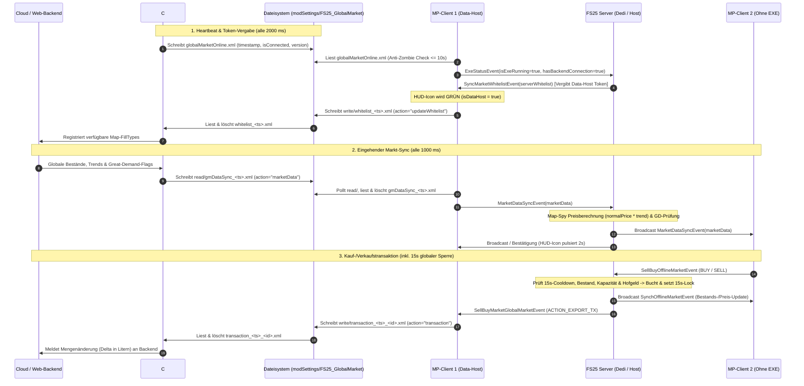

# GlobalMarket – Externe Schnittstellen-Spezifikation & Datenverkehr: Lua <-> Client XML-Bridge

> [!NOTE]
> **Implementierungs-Hinweis (`GlobalMarketClient`):** Diese Spezifikation definiert das verbindliche XML-Austauschprotokoll zwischen dem Lua-Mod (`FS25_GlobalMarket` / künftige Editionen) und dem offiziellen Cross-Platform-Client **`GlobalMarketClient`** (**Rust + Tauri v2** für Windows, macOS & Linux). Ältere C#-Codebeispiele in diesem Dokument stammen aus der ursprünglichen Entwurfsphase und dienen nur noch als historische Schema-Referenz.

Dieses Dokument ist die verbindliche technische Spezifikation für den Datenverkehr zwischen dem Lua-Mod (`FS25_GlobalMarket`) und der externen Desktop-Applikation (`GlobalMarketClient`) inkl. Online-Backend. Da die GIANTS Engine (Lua-Sandbox) keine direkten HTTP-, TCP- oder WebSocket-Verbindungen nach außen zulässt, erfolgt die gesamte Kommunikation asynchron über XML-Dateien im lokalen ModSettings-Ordner des Spielers.

---

## 1. Verzeichnisstruktur & Datei-I/O-Regeln

### 1.1 Gemeinsames Austausch-Verzeichnis (`modSettings/FS25_GlobalMarket/`)
Sämtliche Dateien der Schnittstelle liegen gebündelt in einem einzigen Ordner innerhalb des FS25-Benutzerprofils:

* **Windows (Standard & OneDrive):**
  `%USERPROFILE%\Documents\My Games\FarmingSimulator2025\modSettings\FS25_GlobalMarket\`
  ```csharp
  string fs25ProfileDir = Path.Combine(
      Environment.GetFolderPath(Environment.SpecialFolder.MyDocuments),
      "My Games", "FarmingSimulator2025"
  );
  string gmBridgeDir = Path.Combine(fs25ProfileDir, "modSettings", "FS25_GlobalMarket");
  ```
* **macOS (Steam):**
  `~/Library/Application Support/FarmingSimulator2025/modSettings/FS25_GlobalMarket/`
* **macOS (App Store):**
  `~/Library/Containers/com.giants-software.farmingsim25/Data/Library/Application Support/FarmingSimulator2025/modSettings/FS25_GlobalMarket/`

> [!IMPORTANT]
> **Pflicht-Anforderung für die EXE (Manuelle Verzeichnisauswahl / Fallback):**
> Viele Spieler nutzen verschobene Dokumenten-Ordner, OneDrive-Sonderpfade oder starten den LS25 mit eigenem `-profile`-Startparameter auf einem anderen Laufwerk.
> Die EXE **muss** daher zwingend eine Funktion / Einstellung bieten, über die der Nutzer das `FarmingSimulator2025`-Profilverzeichnis (bzw. direkt den Ordner `modSettings\FS25_GlobalMarket`) **manuell per Ordner-Dialog auswählen** und dauerhaft in der EXE-Konfiguration speichern kann, falls die automatische Erkennung fehlschlägt!

### 1.2 Übersicht aller Austausch-Dateien

Alle Pfade verstehen sich relativ zu `...\FarmingSimulator2025\modSettings\FS25_GlobalMarket\`:

| Relativer Pfad | Richtung | Lebenszyklus & Zweck |
| :--- | :--- | :--- |
| `globalMarketOnline.xml` | **EXE -> Lua** | **Persistente Statusdatei** (Heartbeat, Backend-Verbindungsstatus, EXE-Version). Wird von Lua alle `2000 ms` gelesen (**nicht gelöscht!**). Beim regulären Beenden der EXE sollte die Datei von der EXE gelöscht oder `isConnected="false"` gesetzt werden. |
| `server_whitelist.xml` | **Lua (Server) -> Lokal** | Statische Übersicht aller auf der geladenen Map erlaubten FillTypes (wird beim Map-Start im Singleplayer bzw. auf dem Host/Server erzeugt). |
| `write/whitelist_<ts>.xml` | **Lua (Data-Host) -> EXE** | **Transferdatei:** Wird vom aktiven Data-Host-Client geschrieben, sobald er vom Server den Data-Host-Token erhält. **EXE liest & löscht diese Datei.** |
| `read/gmDataSync_<ts>.xml` | **EXE -> Lua (Data-Host)** | **Transferdatei:** Eingehende globale Marktdaten (`action="marketData"`). Wird vom Data-Host alle `1000 ms` gepollt. **Lua liest & löscht diese Datei.** |
| `write/transaction_<ts>_<id>.xml` | **Lua (Data-Host) -> EXE** | **Transferdatei:** Ausgehende Kauf-/Verkaufstransaktion (`action="transaction"`). **EXE liest & löscht diese Datei.** |

### 1.3 Verbindliche Datei-I/O-Regeln für C# & Lua
1. **Atomares Schreiben (Schutz vor Halb-Lese-Zugriffen):**
   Da Lua den Ordner `read/` alle `1000 ms` und `globalMarketOnline.xml` alle `2000 ms` pollt, darf die C#-EXE niemals langsam direkt in die Zieldatei streamen.
   * **Best Practice in C#:** Datei erst vollständig als `.tmp`-Datei schreiben, Stream schließen und anschließend per `File.Move(tmpPath, xmlPath, overwrite: true)` atomar umbenennen.
2. **Encoding zwingend UTF-8 OHNE BOM:**
   Der C++-XML-Parser der GIANTS Engine verweigert Dateien mit UTF-8 Byte Order Mark (`EF BB BF`). In C# daher immer `new UTF8Encoding(encoderShouldEmitUTF8Identifier: false)` verwenden.
3. **Wildcard-Routing im `write/`-Ordner:**
   Die EXE überwacht im Ordner `modSettings/FS25_GlobalMarket/write/` alle `*.xml`-Dateien, wertet das Root-Element `<gmDataSync action="...">` aus (`updateWhitelist` vs. `transaction`) und löscht die Datei nach erfolgreicher Verarbeitung sofort (`File.Delete`).

---

## 2. Rollenverteilung & Netzwerk-Topologie (SP / MP-Host / Dedicated Server)

Die Desktop-Applikation (`FS25_GlobalMarketExe`) läuft **ausschließlich auf Spieler-PCs** (niemals auf einem Dedicated Server). Damit ein Dedicated Server trotzdem am Online-Markt teilnehmen kann, nutzt `FS25_GlobalMarket` ein **dynamisches Data-Host-Token-System**:

* **Szenario A – Singleplayer & Lokal gehosteter Multiplayer (Listen-Server):**
  Der Spieler-PC ist gleichzeitig `Server` und `Client` (`"LOCAL_HOST"`). Läuft auf diesem PC die `FS25_GlobalMarketExe`, übernimmt er direkt die Rolle des `Data-Host`.
* **Szenario B – Dedicated Server mit Spieler-Data-Host:**
  Auf dem Dedicated Server selbst läuft keine EXE (`g_dedicatedServer ~= nil` überspringt jedes lokale Datei-Polling). Sobald sich ein MP-Client verbindet, auf dessen PC die `FS25_GlobalMarketExe` aktiv läuft und `isConnected="true"` meldet, weist der Dedicated Server diesem Client per `SyncMarketWhitelistEvent` den **Data-Host-Token** zu (`isDataHost = true`, **Grünes HUD-Icon**).
  * **Standby / Failover:** Verbinden sich weitere Spieler mit laufender EXE, gehen diese automatisch in den **Standby-Modus** (**Oranges HUD-Icon**). Verlässt der aktive Data-Host das Spiel oder beendet seine EXE, vergibt der Server den Token nahtlos an den nächsten Standby-Client (oder schaltet zurück in den Offline-Modus, falls kein Spieler mehr eine EXE offen hat).
  * **Mitspieler ohne eigene EXE:** Alle anderen Spieler auf dem Server sehen im Menü denselben synchronisierten Online-Markt und können normal kaufen und verkaufen. Der Dedicated Server prüft und bucht die Transaktion autoritativ und leitet den Export-Auftrag automatisch über das Netzwerk an den aktiven Data-Host-Client weiter, der die `write/transaction_<ts>_<id>.xml` für seine lokale EXE ausschreibt.

### Sequenzdiagramm: Kompletter Datenverkehr



---

## 3. Verbindliche XML-Schemata (Datei-Formate)

### 3.1 Heartbeat & Versions-Check (`globalMarketOnline.xml`)
* **Pfad:** `modSettings/FS25_GlobalMarket/globalMarketOnline.xml`
* **Schreiber:** `FS25_GlobalMarketExe` (Intervall: alle **3 bis 5 Sekunden** aktualisieren).
* **Leser:** `GlobalMarketSync.lua` (Intervall: alle `2000 ms`, Datei wird **nicht** gelöscht).
* **XML-Struktur:**
  ```xml
  <?xml version="1.0" encoding="utf-8" standalone="no"?>
  <globalMarketOnline timestamp="1729512000" isConnected="true">
      <version>1.0.0.0</version>
      <minVersion>1.0.0.0</minVersion>
  </globalMarketOnline>
  ```
* **Attribute & Knoten:**
  * `globalMarketOnline#timestamp` (`int`, Pflicht): Aktueller UTC Unix-Timestamp in Sekunden (`DateTimeOffset.UtcNow.ToUnixTimeSeconds()`).
    * **Anti-Zombie-Regel:** Ist `math.abs(os.time() - timestamp) > 10`, stuft Lua die EXE sofort als beendet/abgestürzt ein (`isExeRunningLocal = false`).
    * **Sauberer Shutdown:** Beim regulären Schließen der EXE sollte die Datei gelöscht oder `timestamp="0"` gesetzt werden, damit das Spiel ohne 10s-Wartezeit sofort in den Offline-Modus wechselt.
  * `globalMarketOnline#isConnected` (`bool`, Pflicht, `"true"` / `"false"`): Gibt an, ob die EXE eine aktive Verbindung zum Online-Backend hat. Bei `"false"` wird das HUD-Icon im Spiel **Rot** und der Markt fällt auf die Offline-Simulation zurück.
  * `globalMarketOnline.version` (`string`, Pflicht): Aktuelle 4-stellige Versionsnummer der laufenden EXE (`MAJOR.MINOR.PATCH.BUILD`).
  * `globalMarketOnline.minVersion` (`string`, Pflicht): Vom Online-Backend beim Handshake/Heartbeat vorgegebene Mindestversion der EXE (`MAJOR.MINOR.PATCH.BUILD`).
    * **Zweck (Remote Force-Update ohne Mod-Update):** Selbst wenn das Backend eine veraltete EXE ablehnt (`isConnected="false"`), muss die EXE die vom Backend gemeldete `minVersion` in die `globalMarketOnline.xml` eintragen. Ist dieser Wert höher als der im Lua-Mod hinterlegte Standardwert (`self.minExeVersion`), übernimmt Lua sofort die höhere `minVersion` vom Backend, blockiert die Online-Freigabe (`version < minVersion`) und blendet dem Spieler im Spiel die Blinkwarnung `ui_gm_warning_exe_outdated` (*„Bitte neue EXE herunterladen"*) ein!

---

### 3.2 Whitelist, Map-Discovery & Backend-Moderations-Workflow (`write/whitelist_<timestamp>.xml` & `server_whitelist.xml`)
* **Pfad 1 (Primärer Trigger für die EXE im Ordner `write/`):**
  `modSettings/FS25_GlobalMarket/write/whitelist_<timestamp>.xml`
* **Pfad 2 (Statisches Backup direkt im ModSettings-Ordner, nur auf Server/SP):**
  `modSettings/FS25_GlobalMarket/server_whitelist.xml`
* **Hintergrund & Zweck (Dynamische FillType-Erkennung mit Moderations-Schranke):**
  Anders als in früheren LS-Versionen (mit starrer FillType-Liste) erkennt `FS25_GlobalMarket` beim Spielstart dynamisch **alle** auf der Map und durch aktive Mods registrierten FillTypes.
  * Damit einerseits neue sinnvolle Mod-Güter (wie `SPELT` / Dinkel, `RYE` / Roggen, `LUPROSIL`, `LAVENDER` usw.) ohne Code-Update ins Online-Backend aufgenommen werden können, andererseits aber verhindert wird, dass Spieler unpassende oder absurde Spaß-FillTypes in das weltweite Online-Netzwerk einspeisen, schickt das Spiel beim Verbinden alle lokal gefundenen FillTypes samt Herkunfts- und Kategorie-Metadaten an die EXE / das Backend.
* **XML-Struktur in `write/whitelist_<timestamp>.xml` (wird von der EXE gelesen & gelöscht):**
  ```xml
  <?xml version="1.0" encoding="utf-8" standalone="no"?>
  <gmDataSync action="updateWhitelist" lang="de">
      <whitelist>
          <item name="WHEAT" title="Weizen" category="GRAINS" type="BULK" basePrice="0.333000" source="BASEGAME" />
          <item name="LUPROSIL" title="Luprosil" category="LIQUIDS" type="PALLET" basePrice="1.200000" source="FS25_CCM_Production_Pack" />
          <item name="SPELT" title="Dinkel" category="GRAINS" type="BULK" basePrice="0.360000" source="FS25_MapName" />
      </whitelist>
  </gmDataSync>
  ```
* **XML-Struktur in `server_whitelist.xml` (statische Referenzdatei):**
  ```xml
  <?xml version="1.0" encoding="utf-8" standalone="no"?>
  <gmServerWhitelist lang="de">
      <item name="WHEAT" title="Weizen" category="GRAINS" type="BULK" basePrice="0.333000" source="BASEGAME" />
      <item name="LUPROSIL" title="Luprosil" category="LIQUIDS" type="PALLET" basePrice="1.200000" source="FS25_CCM_Production_Pack" />
  </gmServerWhitelist>
  ```
* **Attribute im Detail:**
  * `lang` (`string` am Root-Knoten, z. B. `"de"`, `"en"`, `"fr"`, `"es"`, `"pl"`): Aktuelle Spielsprache des Servers/Data-Hosts (`g_languageShort`). Damit weiß das Backend, zu welcher Sprache das `title`-Attribut gehört, und kann über verschiedene Spieler hinweg automatisch mehrsprachige Anzeigenamen in der Datenbank sammeln.
  * `name` (`string`): Interner GIANTS FillType-Identifier (immer Großbuchstaben, Primärschlüssel zwischen Spiel und Backend).
  * `title` (`string`): Lokalisierter Anzeigename in der unter `lang` angegebenen Sprache.
  * `category` (`string`): Klassifizierte Produktgruppe im Markt (`"GRAINS"`, `"ROOT_VEG"`, `"GREENS_SPECIAL"`, `"BALES_SILAGE"`, `"LIQUIDS"`, `"INPUTS_FERT"`, `"PRODUCTS_PALLETS"`). Hilft dem Backend bei der automatischen Einordnung und Vergabe von Standard-Marktkapazitäten nach einer Freigabe.
  * `type` (`string`): Primäre Gebindeform (`"BULK"` = Schüttgut/Flüssigkeit, `"BALE"` = Ballen, `"PALLET"` = Palette/BigBag).
  * `basePrice` (`float`): Unmodifizierter Basispreis pro Liter aus der FillType-Definition (`fillTypeDesc.pricePerLiter`).
  * `source` (`string`): `"BASEGAME"` bei originalen GIANTS-FillTypes oder der exakte Mod-Ordnername (z. B. `"FS25_CCM_Production_Pack"`), aus dem der FillType stammt.

* **Empfohlener Backend-Moderations-Ablauf (3-Status-Modell im Backend):**
  Beim Empfang der `updateWhitelist`-Daten gleicht das Backend jeden `name` mit seiner Datenbank ab:
  1. **`APPROVED` (Freigegeben):** FillType ist im globalen Online-Markt aktiv $\rightarrow$ Backend liefert Bestände (`fillLevel`) und `trend` im `marketData`-Sync aus.
  2. **`PENDING` (Neu / Prüfung ausstehend):** Das Backend kennt diesen FillType noch nicht $\rightarrow$ Das Backend legt ihn automatisch mit den gelieferten Metadaten (`name`, `title`, `lang`, `category`, `type`, `basePrice`, `source`) in einer **Moderations-Liste (Pending Queue)** für die Backend-Crew an (z. B. Admin-Webpanel oder Discord-Webhook).
  3. **`REJECTED` (Abgelehnt / Gesperrt):** Die Backend-Crew hat diesen FillType als ungeeignet für den weltweiten Markt abgelehnt $\rightarrow$ Er bleibt dauerhaft für den globalen Online-Handel gesperrt und erzeugt keine erneuten Moderations-Meldungen.

---

### 3.3 Eingehender Market-Data-Sync & Hybrid-Modus (`read/gmDataSync_<timestamp>.xml`)
* **Pfad:** `modSettings/FS25_GlobalMarket/read/gmDataSync_<timestamp>.xml`
* **Schreiber:** `FS25_GlobalMarketExe` (immer dann, wenn neue Bestands-/Trenddaten vom Backend eintreffen oder nach einer verarbeiteten Transaktion).
* **Leser:** `GlobalMarketSync.lua` (wird alle `1000 ms` vom Data-Host eingelesen und sofort gelöscht).
* **XML-Struktur:**
  ```xml
  <?xml version="1.0" encoding="utf-8" standalone="no"?>
  <gmDataSync action="marketData">
      <fillTypes>
          <fillType fillType="WHEAT" fillLevel="1450000" trend="0.92" greatDemand="false" status="APPROVED" />
          <fillType fillType="BARLEY" fillLevel="450000" trend="1.05" greatDemand="true" greatDemandBonus="0.25" greatDemandRemaining="200000" status="APPROVED" />
          <fillType fillType="SPELT" fillLevel="0" trend="1.00" greatDemand="false" status="PENDING" />
          <fillType fillType="CUSTOM_JUNK" fillLevel="0" trend="1.00" greatDemand="false" status="REJECTED" />
      </fillTypes>
  </gmDataSync>
  ```
* **Attribute pro `<fillType>`:**
  * `fillType` (`string`, Pflicht): Interner GIANTS FillType-Name (z. B. `"WHEAT"`). Unbekannte FillTypes, die auf der aktuellen Map nicht existieren, werden von Lua sicher ignoriert.
  * `status` (`string`, Optional, Default `"APPROVED"`): Moderationsstatus des FillTypes im Backend:
    * `"APPROVED"` (oder Attribut weggelassen): Offiziell im Online-Markt freigegeben. Nutzt Online-Bestand (`fillLevel`), Online-`trend` und exportiert Käufe/Verkäufe als `transaction_*.xml` an die EXE.
    * `"PENDING"`: Dem Backend gemeldet, wartet noch auf Freigabe durch die Backend-Crew. *(Hinweis: Auch jeder lokale Map-FillType, der im `marketData`-Paket gar nicht auftaucht, wird von Lua automatisch als `"PENDING"` behandelt).*
    * `"REJECTED"`: Vom Backend für den Online-Handel abgelehnt.
  * `fillLevel` (`int`, Pflicht bei `APPROVED`): Aktueller globaler Marktbestand in **Litern** (`>= 0`). Begrenzt im Spiel die maximal kaufbare Menge.
  * `trend` (`float`, Optional, empfohlen bei `APPROVED`): Vom Backend berechneter Preis-Multiplikator relativ zum Normalpreis (`1.00 = 100%`).
    * **Wertebereich & Bedeutung im Spiel:**
      * `0.70` = Markt komplett gesättigt / voll (Minimalpreis `-30%`)
      * `< 0.95` = **Roter Pfeil nach unten** (Preis fällt, mehr als `-5%` unter Normalpreis)
      * `0.95 .. 1.05` = Neutraler Preisbereich (kein Pfeil)
      * `1.00` = Exakter lokaler Karten-Durchschnittspreis (`normalPrice`)
      * `> 1.05` = **Grüner Pfeil nach oben** (Preis steigt, mehr als `+5%` über Normalpreis)
      * `1.30+` = Markt leer / extrem knapp (Maximalpreis `+30%` oder mehr bei Großer Nachfrage)
    * *Fallback:* Wird `trend` weggelassen oder `<= 0` übergeben, berechnet Lua den Trendfaktor lokal aus `fillLevel / GlobalMarket.MARKET_CAPACITY` zwischen `0.70` und `1.30`.
  * `greatDemand` (`bool`, Optional, Default `"false"`): Im Online-Modus ist das Backend **alleinig autoritativ** für Große Nachfragen (Lua löst online keine lokalen Knappheits-Nachfragen von selbst aus). Wenn `"true"`, markiert Lua dieses Produkt sofort als **Große Nachfrage** (blauer Pfeil in der Marktliste + einmalige HUD-Benachrichtigung an alle Spieler auf dem Server). Das Backend kann Große Nachfragen somit zu beliebigen Uhrzeiten starten und nach Ablauf eines Server-Timers (z. B. 2 Stunden) oder nach Erreichen eines globalen Liefervolumens (z. B. `200.000 L` über eingehende `SELL`-Transaktionen) durch Setzen von `greatDemand="false"` wieder beenden.
  * `greatDemandBonus` (`float`, Optional, z. B. `"0.25"` für `+25%`): Optionaler Zusatz-Bonus, den Lua während einer aktiven Online-Großen-Nachfrage (`greatDemand="true"`) auf den `trend`-Faktor addiert. (Wird weder `trend` noch `greatDemandBonus` mitgeliefert, wendet Lua bei `greatDemand="true"` automatisch `+0.25` auf den Sättigungspreis an).
  * `greatDemandRemaining` (`int`, Optional, z. B. `"200000"`): Optionales verbleibendes globales Nachfrage-Volumen in Litern für spätere UI-/Tooltip-Anzeigen.

> [!TIP]
> **In-Game Hybrid-Modus für `PENDING` & `REJECTED` FillTypes:**
> FillTypes einer Mod-Map, die im Backend noch auf `"PENDING"` (Prüfung ausstehend) oder `"REJECTED"` (abgelehnt) stehen, gehen für den Spieler nicht verloren: Sie werden im Markt-UI für den Spieler entsprechend gekennzeichnet (z. B. *„Prüfung ausstehend / Offline"* bzw. *„Nur Offline"*), laufen im Hintergrund lokal über die Offline-Simulation der Karte weiter und **erzeugen beim Kauf/Verkauf niemals eine `transaction_*.xml` an die EXE**. Sobald die Backend-Crew einen `"PENDING"`-FillType auf `"APPROVED"` schaltet, wechselt er beim nächsten `marketData`-Sync im Spiel nahtlos in den echten Online-Handel!

> [!NOTE]
> **Anti-Arbitrage & Map-Spy Architektur:**
> Das Backend bzw. die EXE sendet **niemals** fixe Euro-Preise! Da jede FS25-Map, jeder Schwierigkeitsgrad (*Einfach / Normal / Schwer*) und jede Jahreszeit eigene Preisniveaus hat, ermittelt der FS25-Server über den **Map Spy** (`getMapBasePricePerLiter`) den echten lokalen Durchschnittspreis aller Verkaufsstationen der Karte (`normalPrice` pro 1.000 L) und multipliziert diesen mit dem `trend`-Faktor der EXE (`price = normalPrice * trend`).

---

### 3.4 Ausgehender Transaktions-Export & 15s-Sperre (`write/transaction_<timestamp>_<counter>.xml`)
* **Pfad:** `modSettings/FS25_GlobalMarket/write/transaction_<timestamp>_<counter>.xml` (z. B. `transaction_1729512015_1.xml`)
* **Schreiber:** `GlobalMarketSync.lua` (`GlobalMarket:exportTransaction`), ausgelöst nach jeder vom FS25-Server autoritativ geprüften und gebuchten Kauf-/Verkaufstransaktion.
* **Globale 15-Sekunden-Transaktionssperre (`transactionCooldown = 15s`):**
  Sobald im Online-Modus irgendein Spieler auf dem Server eine Kauf- oder Verkaufstransaktion ausführt, sperrt der FS25-Server für **15 Sekunden** serverweit alle weiteren Online-Transaktionen für sämtliche Spieler, damit die EXE das Transaktions-Delta an das Backend melden und den neuen Marktbestand zurücksynchronisieren kann.
* **Leser:** `FS25_GlobalMarketExe` (liest die Datei, sendet das Mengen-Delta an das Backend und löscht die Datei).
* **XML-Struktur:**
  ```xml
  <?xml version="1.0" encoding="utf-8" standalone="no"?>
  <gmDataSync action="transaction">
      <entry fillType="WHEAT" amount="50000" type="BUY" />
  </gmDataSync>
  ```
* **Attribute von `<entry>`:**
  * `fillType` (`string`, Pflicht): Interner GIANTS FillType-Name (z. B. `"WHEAT"`).
  * `amount` (`int`, Pflicht): Gehandelte Menge in **ganzen Litern** (`> 0`).
    * *Wichtig:* Auch wenn der Spieler im Spiel Stückgut (Paletten, BigBags oder Ballen) kauft oder verkauft, rechnet Lua die Stückzahl vor dem Export automatisch in das exakte **Liter-Volumen** um! Das Backend arbeitet für den Rohstoffmarkt also durchgängig in **Litern**.
  * `type` (`string`, Pflicht):
    * `"BUY"` = Spieler hat Ware vom Globalen Markt gekauft $\rightarrow$ **Backend muss den globalen Bestand um `amount` Liter verringern.**
    * `"SELL"` = Spieler hat Ware an den Globalen Markt verkauft $\rightarrow$ **Backend muss den globalen Bestand um `amount` Liter erhöhen.**

---

## 4. HUD-Status-Icon im Spiel (`GameInfoDisplay`)

Links neben der oberen rechten HUD-Leiste zeigt der Mod den aktuellen Verbindungsstatus der EXE farbcodiert an:

| Farbe | RGB-Wert | Bedeutung |
| :--- | :--- | :--- |
| **Grün** | `0.3, 0.8, 0.0` | Lokale EXE läuft (`timestamp` aktuell), `isConnected="true"` und dieser Client ist aktiver **Data-Host**. |
| **Orange** | `1.0, 0.5, 0.0` | Lokale EXE läuft und `isConnected="true"`, aber ein anderer Spieler hält aktuell den Data-Host-Token (**Standby / Failover**). |
| **Rot** | `1.0, 0.0, 0.0` | Lokale EXE läuft, meldet aber `isConnected="false"` (keine Verbindung zum Backend-Server). |
| **Grau** | `0.5, 0.5, 0.5` | Keine lokale EXE aktiv (`Offline-Modus` oder regulärer MP-Client ohne eigene EXE). |

* **Pulsieren:** Bei jedem verarbeiteten `gmDataSync_<timestamp>.xml`-Paket pulsiert das HUD-Icon für `2 Sekunden`.

---

## 5. Konsolen-Befehle zum Testen der Schnittstelle im Spiel

Solange die `FS25_GlobalMarketExe` und das Backend noch in der Entwicklung sind, ist das Datei-Polling in `GlobalMarket.lua` standardmäßig deaktiviert (`GlobalMarket.ENABLE_ONLINE_SYNC = false`).

Zum Testen der EXE-Kommunikation stehen in der FS25-Entwicklerkonsole (`^` / `~`) folgende Befehle bereit:
1. **`gmToggleOnlineSync`** (bzw. `gmToggleOnlineSync true` / `gmToggleOnlineSync false`):
   Schaltet die Online-Synchronisation zur Laufzeit scharf bzw. wieder ab, ohne das Spiel neu starten zu müssen.
2. **`gmTestStatus <0|1|2|3>`**:
   Simuliert die 4 Zustände des HUD-Icons (`0 = Grau/Aus`, `1 = Orange/Standby`, `2 = Grün/Data-Host`, `3 = Rot/Backend getrennt`).
3. **`gmExportData`**:
   Exportiert sämtliche FillTypes, Paletten, BigBags und Ballen der aktuell geladenen Map inkl. Kapazitäten und Basispreisen als Referenz-XML in den `modSettings/FS25_GlobalMarket/`-Ordner.

---

## 6. Empfohlene C#-Datenklassen (`System.Xml.Serialization`)

Für die direkte XML-Serialisierung und -Deserialisierung in C# können folgende Klassen verwendet werden:

### 6.1 Heartbeat (`globalMarketOnline.xml`)
```csharp
using System.Xml.Serialization;

[XmlRoot("globalMarketOnline")]
public class GlobalMarketOnline
{
    [XmlAttribute("isConnected")]
    public bool IsConnected { get; set; } = true;

    [XmlAttribute("timestamp")]
    public long Timestamp { get; set; } // Current UTC Unix Timestamp (Seconds)

    [XmlElement("version")]
    public string Version { get; set; } = "1.0.0.0";

    [XmlElement("minVersion")]
    public string MinVersion { get; set; } = "1.0.0.0"; // Provided by Backend
}
```

### 6.2 Datensynchronisation (`gmDataSync` für `read/` und `write/`)
```csharp
using System.Collections.Generic;
using System.Xml.Serialization;

[XmlRoot("gmDataSync")]
public class GmDataSync
{
    [XmlAttribute("action")]
    public string Action { get; set; } // "updateWhitelist" | "marketData" | "transaction"

    [XmlAttribute("lang")]
    public string Lang { get; set; } // e.g. "de", "en" (used in action="updateWhitelist")

    // 1. action="updateWhitelist" (write/whitelist_<ts>.xml)
    [XmlArray("whitelist")]
    [XmlArrayItem("item")]
    public List<WhitelistItem> Whitelist { get; set; }

    // 2. action="marketData" (read/gmDataSync_<ts>.xml)
    [XmlArray("fillTypes")]
    [XmlArrayItem("fillType")]
    public List<MarketItem> FillTypes { get; set; }

    // 3. action="transaction" (write/transaction_<ts>_<id>.xml)
    [XmlElement("entry")]
    public List<TransactionItem> Transactions { get; set; }
}

public class WhitelistItem
{
    [XmlAttribute("name")]
    public string Name { get; set; }

    [XmlAttribute("title")]
    public string Title { get; set; }

    [XmlAttribute("category")]
    public string Category { get; set; } // e.g. "GRAINS", "LIQUIDS", "BALES_SILAGE", "PRODUCTS_PALLETS"

    [XmlAttribute("type")]
    public string Type { get; set; } // "BULK" | "BALE" | "PALLET"

    [XmlAttribute("basePrice")]
    public float BasePrice { get; set; }

    [XmlAttribute("source")]
    public string Source { get; set; } // "BASEGAME" or Mod Name
}

public class MarketItem
{
    [XmlAttribute("fillType")]
    public string FillType { get; set; }

    [XmlAttribute("fillLevel")]
    public long FillLevel { get; set; }

    [XmlAttribute("trend")]
    public float Trend { get; set; } = 1.0f;

    [XmlAttribute("greatDemand")]
    public bool GreatDemand { get; set; } = false;

    [XmlAttribute("greatDemandBonus")]
    public float GreatDemandBonus { get; set; } = 0.0f;

    [XmlAttribute("greatDemandRemaining")]
    public long GreatDemandRemaining { get; set; } = 0;

    [XmlAttribute("status")]
    public string Status { get; set; } = "APPROVED"; // "APPROVED" | "PENDING" | "REJECTED"
}

public class TransactionItem
{
    [XmlAttribute("fillType")]
    public string FillType { get; set; }

    [XmlAttribute("amount")]
    public long Amount { get; set; } // Volume in Liters

    [XmlAttribute("type")]
    public string Type { get; set; } // "BUY" | "SELL"
}
```

---

## 7. Ausblick: Erweiterbarkeit über `<gmDataSync action="...">`

Der XML-Parser in `GlobalMarketSync.lua` und der Datei-Monitor in der `FS25_GlobalMarketExe` werten das Root-Attribut `<gmDataSync action="...">` polymorph aus. Unbekannte `action`-Werte sollten in C# kommentarlos übersprungen werden.

Dadurch kann dieselbe `read/`- und `write/`-Ordnerstruktur in zukünftigen Ausbaustufen für weitere geplante Handelsbereiche (wie einen späteren **Viehhandel** oder **Gebrauchtmaschinen-Markt**) genutzt werden, ohne den Dateitransport-Mechanismus ändern zu müssen. Die genauen XML-Parameter dieser zukünftigen Erweiterungen werden separat spezifiziert, sobald deren In-Game-Architektur ausgearbeitet wird.
